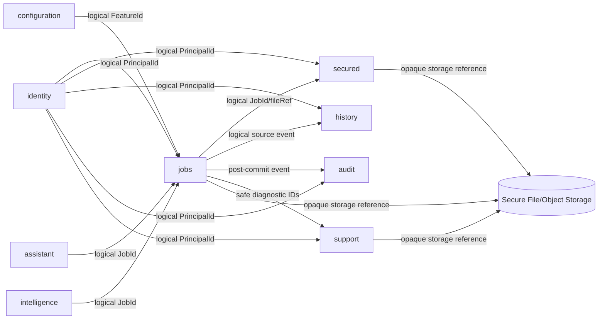
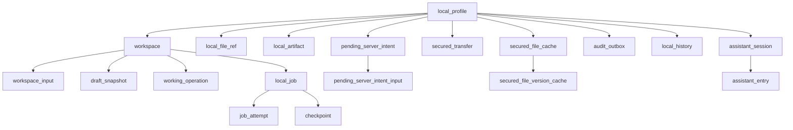

# 07 — DESAIN DATABASE
## PERTAMINA OTO — Office Tools Organizer

> **Standar bahasa:** Bahasa Indonesia — ID-1.0

> **Versi:** 1.0  
> **Tanggal:** 24 Agustus 2026  
> **Status:** FINAL — PRE-CODING BASELINE  
> **Keputusan database:** 12/12 AUTO-LOCKED  
> **Baseline fitur canonical:** 550  
> **Prioritas penyampaian utama:** 33 Primary PDF Tool Cards

---

# 1. Tujuan dan Ruang Lingkup

Dokumen ini menetapkan desain logis database sebelum coding untuk:

- Microsoft SQL Server sebagai database server;
- Entity Framework Core sebagai ORM;
- SQLite sebagai penyimpanan metadata/state lokal pada Desktop dan Mobile/Tablet;
- filesystem lokal aman serta file/object storage aman yang disetujui untuk payload;
- kepemilikan, schema, entity, key, constraint, concurrency, transaction, migration, index, retention, cleanup, backup, recovery, governance, dan traceability.

Dokumen ini tidak memilih edisi/topologi SQL Server, package enkripsi SQLite, vendor object storage, RPO/RTO, durasi retensi legal, atau angka kapasitas tanpa bukti yang disetujui.

Dokumen ini tidak memuat kode aplikasi atau DDL Produksi.

---

# 2. Baseline Berwenang

| Sumber | Baseline |
|---|---|
| Business Process | FINAL v3.4 |
| Requirement Specification | FINAL v1.5 |
| Feature Catalog | FINAL v1.3 — 550 canonical features |
| Solution Design | FINAL v1.2 — 18/18 decisions LOCKED |
| Technical Reference | FINAL v1.2 — 15/15 decisions LOCKED |
| API Documentation | FINAL v1.0 — 9/9 decisions LOCKED |
| Master Project Summary | Snapshot terakhir yang disetujui |

Masukan specialist yang diintegrasikan:

- Agent A — SQL Server;
- Agent B — SQLite Lokal dan Sinkronisasi Selektif;
- Agent C — Kinerja Database;
- Agent D — Tata Kelola Data dan Ketertelusuran.

Audit integrasi dicatat dalam `DATABASE_INTEGRATION_AUDIT.md`. Keputusan dicatat dalam `DATABASE_DECISION_REGISTER.md`.

---

# 3. Keputusan Database yang Dikunci

| ID | Keputusan yang dikunci |
|---|---|
| `DB-AUTO-001` | Satu baseline SQL Server; schema dimiliki modul |
| `DB-AUTO-002` | Metadata SQL + payload object aman; tanpa BLOB SQL secara default |
| `DB-AUTO-003` | Key internal sempit + ID resource publik opaque |
| `DB-AUTO-004` | FK dalam modul; referensi logis lintas modul |
| `DB-AUTO-005` | Idempotency milik domain dan transactional outbox |
| `DB-AUTO-006` | Optimistic concurrency, transaksi singkat, serta guard lease/sequence |
| `DB-AUTO-007` | Kepemilikan DbContext dan migration per modul |
| `DB-AUTO-008` | SQLite per profil/perangkat; file lokal berada di luar SQLite |
| `DB-AUTO-009` | Transfer aman eksplisit; tanpa sinkronisasi workspace generik |
| `DB-AUTO-010` | History, Audit, Support, dan Observability merupakan plane terpisah |
| `DB-AUTO-011` | Maksimum tiga secured version yang aktif/dapat diakses |
| `DB-AUTO-012` | Indeks berbasis bukti dan Worker siklus hidup yang terbatas |

---

# 4. Prinsip Desain Database

1. **Offline-First dan Local-First.** Pekerjaan yang mampu berjalan lokal tidak bergantung pada persistensi server.
2. **Satu pemilik penulisan.** Setiap tabel/resource memiliki satu pemilik logis dan satu pemilik migration.
3. **Tanpa penulisan langsung lintas modul.** Interaksi menggunakan kontrak aplikasi atau event internal setelah commit.
4. **REST berwenang.** Resource REST server mencerminkan state tersimpan; SignalR hanya memberi notifikasi atas revisi yang telah di-commit.
5. **Metadata di SQL.** Konten biner dan terbatas tetap berada di file/object storage yang sesuai.
6. **Bertipe dan berversi.** Schema Feature, parameter, workflow, policy, state JSON, event, dan migration memiliki versi eksplisit.
7. **Referensi publik opaque.** ID publik, `fileRef`, referensi storage, cursor, ETag, Job ID, dan Correlation ID tidak pernah memberi akses.
8. **Penanganan sumber non-destruktif.** File asli/sumber tidak pernah ditimpa atau dihapus diam-diam.
9. **Pekerjaan terbatas.** Query, retry, queue, export, cleanup, archive, dan reconciliation memiliki batas keamanan tegas.
10. **Data minimum.** Simpan hanya field yang diperlukan untuk perilaku produk, recovery, keamanan, audit, atau dukungan.
11. **Siklus hidup independen.** Retention history, audit, job, file, issue, log, cache, dan export tidak saling cascade.
12. **Bukti sebelum optimasi.** Full-text, partitioning, replica, columnstore, atau indeks berlebihan tidak dibuat secara spekulatif.

---

# 5. Arsitektur Penyimpanan

```text
LOCAL DEVICE
├─ User filesystem
│  ├─ original/source file
│  └─ ordinary local final result
├─ App-managed protected filesystem
│  ├─ draft state artifact
│  ├─ cache/thumbnail/temp
│  ├─ checkpoint/intermediate
│  ├─ local result when app-managed
│  └─ optional explicitly saved visual signature asset
└─ SQLite per local profile/device
   ├─ metadata and state
   ├─ operation log and recovery
   ├─ local job and queue
   ├─ personal local history
   └─ selective-sync/cache metadata

SERVER
├─ Microsoft SQL Server
│  ├─ identity/authorization/configuration
│  ├─ jobs/upload/idempotency/outbox
│  ├─ secured-file metadata
│  ├─ personal server history
│  ├─ enterprise audit
│  ├─ issue/support
│  └─ assistant/intelligence operational metadata
└─ Approved secure file/object storage
   ├─ temporary processing input/result
   ├─ secured files and versions
   ├─ issue attachment/export
   └─ content-bearing checkpoint/artifact when approved
```

## 5.1 Aturan Penempatan

| Data | SQL Server | SQLite | File/object storage |
|---|:---:|:---:|:---:|
| Metadata/state resource server | YA | Hanya proyeksi cache | TIDAK |
| Metadata/state workspace lokal | TIDAK | YA | Hanya artefak lokal besar |
| Byte dokumen/file | TIDAK secara default | TIDAK | YA |
| Payload file/version yang diamankan | Hanya metadata | Metadata cache | YA — penyimpanan server aman yang disetujui |
| Pesan/catatan masalah | YA — hanya Support | Hanya draft sebelum dikirim | Hanya attachment/export |
| Enterprise Audit | YA — metadata aman | Outbox metadata offline | Hanya artefak export |
| Password/token/secret/key | NO | NO | Approved credential/key boundary only |
| Full OCR/extracted text | NO metadata table | Only protected working artifact if required | Temporary approved content store |
| Visual signature asset | NO server default | Metadata only if explicitly saved | Protected local artifact only |

---

# 6. Desain Logis SQL Server

## 6.1 Skema dan Kepemilikan

| Schema | Pemilik penulisan | Tanggung jawab |
|---|---|---|
| `identity` | Account Administration — Identity | Principal mapping and session/revocation metadata |
| `admin` | Account Administration — Authorization | Roles, permissions, assignments |
| `configuration` | Platform Configuration | Feature snapshot, exposure, flags, policies, compatibility |
| `workspace` | Workspace Metadata | Allowlisted lightweight account preferences/favorites/presets only |
| `jobs` | Processing/Jobs | Job, upload, attempts, checkpoints, artifacts, admission, idempotency, outbox |
| `secured` | Secured Files | Explicit Amankan ke Akun metadata, versions, account recycle lifecycle |
| `history` | History | Personal server/account activity projection |
| `audit` | Enterprise Audit | Safe append-only evidence and export request metadata |
| `support` | Issue and Support | Issue, attachment metadata, notes, triage, export, idempotency, outbox |
| `assistant` | Assistant | Minimal server invocation/workflow metadata |
| `intelligence` | Content Intelligence | Server intelligence operation/stage metadata |

`identity` dan `secured` adalah nama logis fisik. Nama resource API tetap `/account/...` dan `/secured-files/...`; nama schema database bukan kontrak publik.

Modul aplikasi tidak menggunakan `dbo` sebagai schema bersama tanpa pemilik. `dbo` hanya untuk objek DBA/deployment yang disetujui secara eksplisit.

## 6.2 ERD Server Tingkat Tinggi



Panah antarschema menunjukkan hubungan logis aplikasi, kecuali kedua entity memiliki pemilik penulisan yang sama. Panah bukan otorisasi atau FK lintas schema otomatis.

---

# 7. Katalog Entitas SQL Server

## 7.1 Identitas dan Administrasi

| Tabel | Tujuan | Invarian kritis |
|---|---|---|
| `identity.Principals` | Internal principal and approved Pertamina identity mapping | Unique public `PrincipalId`; unique issuer + external subject; no token/password |
| `identity.Sessions` | Session/revocation metadata | Hashed session identifier; expiry/revocation; no raw token |
| `admin.Roles` | Role grouping | Unique stable Role Code; role is not final authorization |
| `admin.Permissions` | Canonical permission definitions | Unique Permission Code; migration/version owned |
| `admin.RolePermissions` | Role-permission assignment | Unique role + permission; same-owner FK |
| `admin.PrincipalRoles` | Principal-role assignment | Unique active principal + role; assignment/revocation timestamps |

Dokumen 07 tidak membuat role Superadmin. Permukaan Support tetap dikendalikan permission; pemetaan role final menjadi cakupan Dokumen 09.

## 7.2 Konfigurasi dan Metadata Akun Ringan

| Tabel | Tujuan | Invarian kritis |
|---|---|---|
| `configuration.FeatureDefinitions` | Deployed snapshot of 550 canonical features | `FeatureId` natural key; admin cannot change feature meaning |
| `configuration.FeatureAliases` | Normalized alias/discovery mapping | Unique normalized alias + locale; FK within schema |
| `configuration.FeaturePlatformExposures` | Desktop/Tablet/Phone/Web exposure | Unique Feature ID + Platform Code |
| `configuration.FeatureFlags` | Staged rollout/emergency disable | Unique scoped flag; row version; cannot alter contract semantics |
| `configuration.PolicySets` | Scoped typed policy aggregate | Public policy ID; scope; state; row version |
| `configuration.PolicySetVersions` | Immutable policy versions | Unique policy + version; schema version and content hash |
| `configuration.CompatibilityPolicies` | Client/API compatibility | Unique platform + channel + API major |
| `workspace.UserPreferences` | Allowlisted lightweight account preference | One owner/profile preference aggregate; typed/versioned; no path/content |
| `workspace.FavoriteFeatures` | Optional selected canonical favorites | Unique owner + Feature ID |
| `workspace.Presets` | Optional typed preset metadata | Versioned payload; no file, path, password, token, secret, or content |

Baseline tidak memiliki `workspace.SyncChanges` generik. Jika sinkronisasi preference ringan kelak membutuhkan feed tahan lama, diperlukan allowlist bertipe dan tinjauan desain terkendali; mekanisme itu tidak boleh menjadi replikasi workspace penuh.

## 7.3 Job, Upload, Pemulihan, dan Realtime

| Tabel | Tujuan | Invarian kritis |
|---|---|---|
| `jobs.JobStatuses` | API-visible job status reference | Locked status catalog only |
| `jobs.UploadStatuses` | Upload lifecycle reference | Locked upload catalog only |
| `jobs.Jobs` | Current persisted server job state | Public Job ID unique; owner; feature; row version; lease |
| `jobs.JobAttempts` | Append-only execution attempts | Unique Job + Attempt Number; Job ID unchanged on retry/resume |
| `jobs.JobSteps` | Ordered workflow/job steps | Unique Job + Step Key and Job + Step Order |
| `jobs.JobStateHistory` | Append-only state transition history | Unique Job + Sequence; no update-in-place |
| `jobs.JobInputs` | Typed `fileRef` binding | Unique Job + Input ID; no physical path/storage key |
| `jobs.JobArtifacts` | Result/temp/intermediate metadata | Public Artifact ID unique; object reference; lifecycle/expiry |
| `jobs.JobCheckpoints` | Verified resumable checkpoint metadata | Unique Job + Checkpoint Sequence; compatibility/integrity fields |
| `jobs.UploadSessions` | One-shot/resumable upload lifecycle | Public Upload ID unique; owner; committed offset; expiry; row version |
| `jobs.UploadParts` | Received range/digest metadata | Unique session + range; no duplicate conflicting part |
| `jobs.IdempotencyRecords` | Processing/upload mutation replay | Unique scoped key hash; request fingerprint; safe replay IDs |
| `jobs.AdmissionReservations` | Capacity/quota reservation | Unique active reservation; expiry/release; row version |
| `jobs.OutboxMessages` | Persist-before-notify event | Unique Event ID; unique stream + sequence; safe payload only |

Locked job states:

```text
QUEUED
RUNNING
WAITING_CONNECTION
WAITING_RESOURCE
RETRYING
COMPLETED
FAILED
CANCELLED
```

`PAUSED` dilarang tanpa revisi terkendali. `JobWaiting` dapat menjadi nama event realtime, tetapi tidak membuat state baru.

Locked upload states:

```text
CREATED
UPLOADING
VALIDATING
READY
FAILED
ABORTED
EXPIRED
```

`uploadId` mengidentifikasi siklus hidup transfer. `fileRef` adalah referensi eksekusi opaque bertipe. Eksekusi berbasis upload menggunakan `fileRef.kind=UPLOAD` dan ID upload berstatus `READY`.

## 7.4 File yang Diamankan

| Tabel | Tujuan | Invarian kritis |
|---|---|---|
| `secured.Files` | Logical account-secured aggregate | Public Secured File ID unique; owner; current state/version; row version |
| `secured.FileVersions` | Immutable content-version metadata | Unique file + version number; unique internal storage reference |
| `secured.RecycleEntries` | Account recycle/retention lifecycle | At most one active recycle entry per file; policy timestamps |
| `secured.IdempotencyRecords` | Create/version/restore/delete replay | Unique scoped key hash + operation; safe resource replay |
| `secured.OutboxMessages` | File lifecycle and cleanup events | Unique event/stream sequence; safe metadata |

Invarian maksimum tiga versi:

```text
Create version N
→ validate payload and ownership
→ short aggregate transaction
→ activate version N
→ if active count becomes 4, tombstone oldest active version
→ current pointer and active count commit together
→ post-commit cleanup/archive event
→ idempotent object cleanup and reconciliation
```

Maksimum tiga versi tetap aktif dan dapat diakses. Purge fisik yang gagal dapat menyisakan referensi cleanup internal, tetapi tidak boleh memulihkan akses pengguna ke versi yang telah dirotasi.

## 7.5 Riwayat Pribadi dan Enterprise Audit

| Tabel | Tujuan | Invarian kritis |
|---|---|---|
| `history.Entries` | Personal server/account activity projection | Public History ID; owner; unique source event; user-deletable projection |
| `audit.IngestionBatches` | Idempotent offline audit batch ingestion | Unique batch per source scope; counts/hash/received time |
| `audit.AuditEvents` | Enterprise evidence metadata | Stable Event ID unique; append-only; no ordinary update/delete |
| `audit.ExportRequests` | Bounded asynchronous export request | Public request ID; safe/versioned filter; Job ID logical link |

History dan Audit tidak pernah berbagi tabel. Penghapusan history hanya menghapus proyeksi pribadi. Tindakan ini tidak menghapus bukti job, file yang diamankan, objek hasil, data observability, atau enterprise audit.

Audit menyimpan `OccurredAtUtc` dan `ReceivedAtUtc` untuk event offline/terlambat. Timestamp yang mengendalikan retensi legal ditentukan melalui keputusan kebijakan Audit/Compliance yang disetujui dalam Dokumen 10; Dokumen 07 tidak menetapkannya sendiri.

## 7.6 Pelaporan Masalah dan Dukungan

| Tabel | Tujuan | Invarian kritis |
|---|---|---|
| `support.IssueStatuses` | Internal/user-visible status mapping | Stable status mapping; migration owned |
| `support.IssuePriorities` | Priority reference | Controlled catalog |
| `support.IssueCategories` | Category reference | Controlled catalog |
| `support.Issues` | Issue aggregate and safe context | Public Issue ID; reporter; row version; permission scoped |
| `support.IssueAttachments` | Explicit-send attachment metadata | Public Attachment ID; secure object reference; no SQL blob |
| `support.IssueStatusHistory` | Append-only transitions | Unique Issue + Sequence |
| `support.IssueNotes` | Permission-gated internal notes | Author logical ID; restricted read; retention sensitive |
| `support.IssueRelations` | Duplicate/related issue link | Same-schema FKs; unique relation |
| `support.ExportRequests` | PDF/Excel export job metadata | Filter/version/expiry; object artifact outside SQL |
| `support.IdempotencyRecords` | Submit/mutation replay | Unique scoped key hash; no issue screenshot/content snapshot |
| `support.OutboxMessages` | Reliable status notification | Post-commit safe notification only |

Internal issue states may use the locked specialist catalog:

```text
BARU
DIPERIKSA
PERLU_PERBAIKAN
BUTUH_INFORMASI
DUPLIKAT
BUKAN_BUG
SEDANG_DIPERBAIKI
READY_FOR_TEST
TERVERIFIKASI
SELESAI
```

Status yang ditampilkan kepada pengguna tetap disederhanakan. Pesan/catatan masalah menjadi milik Support dan tidak disalin ke Audit atau telemetry. Byte screenshot hanya diterima setelah preview dan pengiriman eksplisit oleh pengguna.

## 7.7 Assistant dan Content Intelligence

| Tabel | Tujuan | Invarian kritis |
|---|---|---|
| `assistant.InvocationMetadata` | Minimal server invocation metadata | Intent category, resolved Feature ID, status, Correlation ID; no prompt |
| `assistant.WorkflowMetadata` | Validated plan/execution summary | Workflow/schema version, fingerprint, step count, Job ID; no unrestricted plan content |
| `assistant.InternalAiCallMetadata` | Approved internal-provider operation metadata | Provider profile code and safe counters; no request/response content |
| `intelligence.Operations` | Server intelligence operation metadata | Feature, owner, Job, policy/consent outcome, row version |
| `intelligence.OperationStages` | Append-only stages | Unique operation + stage sequence |

Baseline server tidak memiliki tabel `AssistantConversations` atau `AssistantMessages`. Assistant tetap hanya sebagai orchestrator. Prompt, chat, dokumen, OCR, ringkasan, terjemahan, konten Markdown, password, token, clipboard, artefak tanda tangan, dan respons mentah provider dilarang dalam tabel ini.

---

# 8. Kamus Data Server Kritis

## 8.1 `jobs.Jobs`

| Grup field | Field | Aturan |
|---|---|---|
| Identity | `JobPk`, `JobId` | Internal key + opaque public ID |
| Ownership/contract | `OwnerPrincipalId`, `FeatureId`, `ContractVersion`, optional workflow/parameter schema versions | Logical references; no cross-module FK |
| Trace | `CorrelationId` | Indexed for authorized diagnostics; not access proof |
| State | `StatusCode`, `ProgressPercent`, `CurrentStepCode`, counts, safe `ErrorCode` | Current REST authority |
| Queue | `WorkloadClass`, `QueueName`, `AvailableAtUtc`, optional priority | Bounded/fair admission |
| Lease | `LeaseOwner`, `LeaseExpiresAtUtc` | Atomic worker claim/recovery |
| Time | Created, queued, started, completed, expiry UTC fields | UTC only |
| Concurrency | `RowVersion` | Expected version on mutation |

## 8.2 `jobs.UploadSessions`

Minimum fields:

```text
UploadSessionPk
UploadId
OwnerPrincipalId
FeatureId or PurposeCode
StatusCode
DeclaredFileNameSafe
DeclaredMediaType
DetectedMediaType
ExpectedSizeBytes
CommittedOffsetBytes
DigestAlgorithm / ExpectedDigest / ValidatedDigest
TemporaryStorageReference
CreatedAtUtc / UpdatedAtUtc / ExpiresAtUtc
RowVersion
```

Path fisik, URL arbitrer, storage key yang dikendalikan klien, password, token, dan byte file dilarang.

## 8.3 Catatan Idempotency Domain

```text
IdempotencyRecordPk
ScopeHash
OperationHash
KeyHash
HashAlgorithmVersion
RequestFingerprint
State
SafeResourceType / SafeResourceId
SafeResponseStatus
CreatedAtUtc / CompletedAtUtc / ExpiresAtUtc
RowVersion
```

Batas unik adalah `ScopeHash + OperationHash + KeyHash`. Fingerprint yang sama memutar ulang resource logis asli; fingerprint berbeda menghasilkan konflik. Raw key dan body respons tanpa batas tidak disimpan.

## 8.4 `secured.Files` dan `secured.FileVersions`

| Field aggregate | Aturan |
|---|---|
| ID file/version publik | Opaque dan unik |
| Owner Principal ID | Pemilik logis; diperiksa pada setiap operasi |
| Nama tampilan, ekstensi, MIME, ukuran | Metadata sensitif; diminimalkan dan dilindungi |
| Nomor versi/versi aktif | Unik dan diperbarui secara atomik |
| Checksum/ETag | Untuk integritas/concurrency, bukan otorisasi |
| Referensi objek storage | Hanya internal; tidak pernah dikembalikan sebagai otoritas atau field log biasa |
| Field state/tombstone/retention | Siklus hidup eksplisit dan cleanup yang dapat diulang |
| Row version pada aggregate file | Wajib untuk mutasi |

## 8.5 `audit.AuditEvents`

Minimum safe fields:

```text
AuditEventPk / AuditEventId
IngestionBatchPk nullable
OccurredAtUtc / ReceivedAtUtc
ActorPrincipalId / approved role-unit snapshot codes
EventTypeCode / OutcomeStatus
FeatureId / ProcessId / JobId / CorrelationId when applicable
ExecutionLocation / safe size category or bytes
ErrorCode / PlatformCode / AppVersion
Versioned size-limited allowlisted SafeMetadataJson nullable
```

Tidak boleh memuat dokumen, filename/path secara default, password, token, clipboard, screenshot, tanda tangan, teks OCR lengkap, pesan masalah, exception mentah, atau respons provider.

## 8.6 `support.Issues`

Field minimum mencakup reporter, pesan, state, kategori/prioritas, Feature ID/page aktif, versi app/platform/OS yang aman, Error Code, Job ID, Correlation ID, referensi diagnostik tersanitasi, timestamp, dan RowVersion. Akses pesan/catatan dibatasi serta dikecualikan dari proyeksi daftar default/baseline full-text.

---

# 9. Kunci, Relasi, Batasan, dan Penamaan

## 9.1 Penamaan SQL Server

- Schema: nama domain huruf kecil.
- Tabel/kolom/entity: `PascalCase` yang konsisten dengan mapping EF Core.
- Internal PK: `<Entity>Pk`, normally `bigint identity` for high-volume tables.
- Public ID: `<Entity>Id`, opaque and unique.
- FK: `<Parent>Pk` only within one write-owner boundary.
- Logical cross-module reference: public `<Resource>Id` without database FK.
- UTC timestamp: `<Meaning>AtUtc`, `datetime2(7)`.
- Date-only business value: explicit date type and name; never mixed with timestamp.
- Concurrency: `RowVersion`; never call it timestamp.
- Retention: explicit `ExpiresAtUtc`, `RetainUntilUtc`, `DeletedAtUtc`, `PurgeAfterUtc`, or tombstone state.
- Boolean: affirmative name, for example `IsActive`.
- Stable enums: owned short code/reference; no global ownerless Status table.

## 9.2 Penamaan SQLite

- Table/column: `snake_case`.
- ID: opaque `TEXT` locally generated.
- Time: UTC epoch milliseconds; presentation timezone is not persisted authority.
- Boolean: `INTEGER CHECK(value IN (0,1))`.
- Concurrency: `row_version INTEGER` incremented per important mutation.
- JSON: small, typed, versioned, size-bounded; no arbitrary command/content blob.

## 9.3 Batasan

Batasan unik wajib mencakup:

- issuer + external subject;
- public resource IDs;
- canonical Feature ID;
- normalized alias + locale;
- Feature ID + Platform Code;
- Job + Attempt Number;
- Job + state/checkpoint/outbox sequence;
- Upload Session + received range;
- scoped idempotency key hash;
- Secured File + Version Number;
- Audit Event ID;
- owner + source event for idempotent history projection;
- Issue + status sequence;
- SQLite workspace + operation/snapshot sequence.

Check constraint mencakup ukuran/jumlah/rentang, stable code yang diterima, offset/progress non-negatif, boolean valid, validitas JSON bila didukung, dan urutan timestamp bila aman.

Perilaku hapus default adalah `RESTRICT`/`NO ACTION`. Cascade hanya diizinkan untuk child berumur singkat dengan owner yang sama setelah terbukti tidak menghapus bukti atau membuat konten eksternal menjadi orphan.

---

# 10. Konkurensi dan Batas Transaksi

## 10.1 Konkurensi Optimistis

`rowversion` SQL Server wajib pada root yang dapat berubah, seperti Job, Upload Session, Secured File, Recycle Entry, Issue, Policy, Feature Flag, aggregate Preference, Idempotency Record, dan Admission Reservation.

Record append-only menggunakan key sequence/event unik, bukan update row umum.

SQLite mutation carries expected `row_version` and, for workspace changes, expected operation cursor.

Konflik state job, offset upload, secured file, triage issue, policy, workspace, identitas sumber/hasil, atau proyeksi sync tidak boleh diselesaikan dengan last-write-wins diam-diam.

## 10.2 Matriks Transaksi Singkat

| Kasus penggunaan | Di dalam satu transaksi singkat | Di luar transaksi |
|---|---|---|
| Job admission | Idempotency, Job, initial state, reservation, outbox | Validation already completed; worker execution |
| Worker claim | Bounded claim, lease, status/version | Engine/file/provider work |
| Job progress | Coalesced state revision + optional outbox | UI progress calculation and SignalR delivery |
| Job completion | Verified artifact ref, terminal state, attempt, reservation release, outbox/audit intent | Output generation and storage transfer |
| Upload finalize | Validated reference/digest/size, READY state | Stream, scan, deep inspection |
| Secured version | Metadata/current pointer/max-three/tombstone/outbox | Payload transfer and physical purge |
| Issue submit/triage | Issue metadata/state + idempotency/outbox | Screenshot capture/upload, export generation |
| Cleanup claim | Bounded candidates + lease/checkpoint | External object delete/archive |

Transaksi panjang terdistribusi tidak boleh mencakup SQL Server dan object storage sekaligus. Gunakan staging, validasi, commit metadata, promosi/finalisasi, outbox, dan reconciliation.

## 10.3 Isolasi dan Percobaan Ulang

- Default implementation uses short transactions and unique/atomic guards.
- `READ_COMMITTED_SNAPSHOT` is a recommended candidate only after DBA review, `tempdb` sizing, compatibility, and load tests.
- `SERIALIZABLE` is limited to a narrow invariant when unique constraint/atomic update is insufficient.
- Deadlock/transient retries are bounded and only wrap idempotent/transaction-safe database commands.
- Table access order is consistent per aggregate.
- No `NOLOCK` data-consistency shortcut.

---

# 11. Batas EF Core

DbContext logis yang direkomendasikan:

```text
IdentityAdministrationDbContext
ConfigurationDbContext
WorkspaceMetadataDbContext
JobsDbContext
SecuredFilesDbContext
HistoryDbContext
AuditDbContext
SupportDbContext
AssistantDbContext
ContentIntelligenceDbContext
```

Aturan:

1. DbContext hanya mengekspos tabel yang dimiliki modulnya.
2. Navigation property lintas modul atau akses langsung `DbSet` dilarang.
3. Mapping schema/tabel fisik, panjang maksimum, precision, Unicode, perilaku hapus, index, check, dan concurrency token harus eksplisit.
4. Daftar baca diproyeksikan langsung ke DTO/read model dan menggunakan perilaku no-tracking.
5. Lazy loading lintas modul/koleksi besar dilarang.
6. Include koleksi besar, N+1, evaluasi klien, `IN` tanpa batas, dan pemuatan entity graph tanpa batas dilarang.
7. Cancellation dan command timeout terbatas per kategori diteruskan ke operasi database.
8. Mapping EF yang dapat digunakan ulang boleh dibagikan sebagai pola kode; kepemilikan tabel fisik tetap terpisah.
9. Permission database menerapkan least privilege per deployable/modul jika didukung model deployment.

---

# 12. Strategi Migrasi

## 12.1 SQL Server

- Each DbContext owns its migration assembly and migration-history table in its schema.
- A module migration cannot change another module's table.
- Production host must not call automatic startup migration.
- Pipeline produces reviewed idempotent script/bundle, validates target compatibility, backs up, deploys in controlled order, and records evidence.
- Use expand-and-contract for shared contracts: add → dual-compatible read/write if needed → backfill → switch → remove after compatibility window.
- Rename uses add/copy/switch/drop; destructive rename/drop is not a single release action.
- Large backfill runs bounded/chunked with progress, pause/resume, log/capacity monitoring, and rollback/forward-fix plan.
- Reference/status seed changes are explicit migrations; existing historical codes remain readable.
- Forward-fix is preferred after production data migration unless an approved rollback is proven safe.

## 12.2 SQLite

- Ordered forward migrations have stable migration ID, checksum, source/target schema, and supported app range.
- `PRAGMA user_version` may be a quick marker; `schema_migration` is the durable local record.
- App acquires exclusive profile migration lease and blocks job dispatch.
- Preflight checks free storage, power/battery where relevant, schema compatibility, and local backup capability.
- Migration uses transaction when safe; large file/data work uses resumable `migration_journal`.
- Validate foreign keys, schema, critical invariants, artifacts, and local-only sync classification before reopening the app.
- Newer unsupported DB schema is not opened; unsupported downgrade is denied safely.
- Failure preserves the original/backup and must not create an empty database or delete a draft.

Pengujian migration wajib mencakup setiap versi sebelumnya yang didukung, dataset kosong/normal/besar, draft aktif, undo log, checkpoint, pending intent, secured cache, crash pada setiap fase, ruang disk rendah, row/artefak rusak, pergantian akun, dan downgrade yang tidak didukung.

---

# 13. Desain SQLite Lokal

## 13.1 Batas Kepemilikan Lokal

Satu database SQLite dibuka untuk setiap profil OS lokal + profil subjek Pertamina. Pergantian akun menutup store aktif dan membuka store profil lain. Data tidak pernah digabungkan secara implisit.

Semua akses menggunakan abstraksi persistence/aplikasi lokal seperti `ILocalWorkspaceStore`. Satu writer terserialisasi memiliki seluruh mutasi per profil. Worker Lokal Desktop berkomunikasi melalui IPC bertipe/berversi dan tidak memperoleh akses SQLite arbitrer. Callback background Mobile menggunakan batas persistence terserialisasi dan transaksi singkat yang sama.

## 13.2 Katalog Entitas Lokal

### Profil dan Runtime

| Tabel | Tujuan |
|---|---|
| `local_profile` | Isolated profile binding using protected/hashed subject + tenant reference |
| `offline_authorization_snapshot` | Narrow, time-bounded, integrity-protected capability snapshot; no token |
| `app_run` | Start/heartbeat/clean-shutdown marker for crash detection |
| `schema_migration` | Durable local migration history |
| `migration_journal` | Resumable large migration/file-operation steps |

### Workspace dan Artefak

| Tabel | Tujuan |
|---|---|
| `local_file_ref` | Opaque platform locator, identity evidence, safe metadata; no file bytes |
| `workspace` | Active feature/workflow state, dirty/cursor/autosave/version fields |
| `workspace_input` | Ordered input roles and captured identity/fingerprint |
| `draft_snapshot` | Versioned compact state or protected artifact reference |
| `working_operation` | Append-only undo/redo operation log with unique sequence |
| `local_artifact` | Manifest for draft/cache/thumbnail/temp/checkpoint/intermediate/result/signature files |
| `assistant_session` | Minimal local Assistant conversation/workflow session state |
| `assistant_entry` | Protected minimized local turn/intent state; no secret/document content auto-history |

### Job Lokal dan Pemulihan

| Tabel | Tujuan |
|---|---|
| `local_job` | Authoritative local job state and local pending execution view |
| `job_input` | Captured local file identity and transfer requirement |
| `job_attempt` | Append-only local attempt history |
| `checkpoint` | Compatible integrity-validated checkpoint metadata |
| `pending_server_intent` | Typed pre-submission command; no arbitrary URL/body/command |
| `pending_server_intent_input` | Local input refs and upload linkage |
| `server_job_cache` | Non-authoritative REST-derived server job projection |
| `recovery_candidate` | Detected startup recovery item and permitted actions |

### Data Pribadi Lokal dan Sinkronisasi Selektif

| Tabel | Tujuan |
|---|---|
| `local_history` | Personal metadata-only local history |
| `recent_file` | Recent file reference list |
| `user_preference` | Typed local/device preference |
| `favorite_tool` | Canonical Feature ID shortcut |
| `preset` | Typed/versioned local feature/workflow parameters |
| `secured_transfer` | Explicit Amankan ke Akun outbox for one validated selected result/file |
| `secured_file_cache` | Server-derived secured-file catalog cache |
| `secured_file_version_cache` | Server-derived maximum-three-version metadata cache |
| `sync_cursor` | Opaque incremental reconciliation position |
| `sync_conflict` | Local/server version conflict evidence and selected resolution |
| `audit_outbox` | Encrypted metadata-only enterprise audit queue |

## 13.3 ERD Lokal



State berukuran besar atau memuat konten yang direferensikan row ini tetap berada dalam artefak lokal terlindungi, bukan BLOB SQLite.

---

# 14. Workspace Lokal, Autosave, Undo/Redo, dan Pemulihan

## 14.1 Invarian Workspace

- File asli/sumber tetap berada di luar artefak yang dikelola aplikasi dan tidak pernah ditimpa.
- `local_file_ref` records opaque locator and identity evidence to detect `MISSING`, `MOVED`, `ACCESS_REVOKED`, or `CHANGED`.
- Snapshot dan operation cursor di-commit secara atomik.
- New operation after undo truncates or marks the redo branch transactionally.
- Autosave uses debounce/delta/compaction and does not create a full output for every edit.
- Snapshot lama hanya dihapus setelah integritas pengganti tervalidasi.
- Full source hash is computed only when integrity/conflict requires it.

## 14.2 Urutan Penulisan Artefak

```text
create app-managed temporary artifact
→ close/flush
→ validate/checksum
→ atomic rename inside the same managed filesystem
→ commit SQLite pointer and state
→ only then release old artifact when safe
```

Jika intent database harus mendahului pekerjaan eksternal, simpan intent/outbox secara eksplisit dan selesaikan secara idempotent.

## 14.3 Pemulihan Saat Startup

```text
1. Acquire single-profile writer lock
2. Open SQLite with foreign keys and approved journal settings
3. Validate/migrate schema before dispatch
4. Detect unclean app_run
5. Let SQLite recover journal/WAL; run bounded integrity check
6. Expire stale execution/queue/cleanup leases
7. Reconcile app-managed temp/checkpoint manifests
8. Classify draft/job/transfer recovery candidates
9. REST GET any known server Job ID
10. Retry ambiguous submission with the same Idempotency-Key
11. Validate input fingerprint and checkpoint compatibility
12. Offer Lanjutkan / Coba Lagi / Batalkan
```

`RUNNING` tanpa lease Worker lokal aktif menjadi kandidat recovery, bukan selesai. Keluaran parsial/temp tidak pernah menjadi final. Secret/password diminta kembali bila diperlukan dan tidak dipulihkan dari persistence.

---

# 15. Sinkronisasi Selektif, Queue Offline, dan Konflik

## 15.1 Aturan Struktur Sinkronisasi

Local-only tables have no sync trigger, generic outbox mapping, or database replication flag.

```text
NO AUTO-SYNC
source
draft / working state
undo / redo
cache / thumbnail / temp
checkpoint
clipboard
password / token / secret
visual signature asset
local history / recent file
Assistant conversation
```

Content outbound paths are distinct:

1. **Execution transfer** — temporary upload for an Optional/Required server execution after resolver, policy, permission, capacity, connectivity, and consent checks. This is not backup/sync.
2. **Secured transfer** — explicit **Amankan ke Akun** for one eligible validated file/final result.
3. **Audit outbox** — approved enterprise metadata only; no content.
4. **Account preferences** — allowlisted typed metadata through `/account/preferences`; never a generic workspace sync channel.

## 15.2 State Transfer Aman

```text
REQUESTED
→ PREPARING
→ WAITING_CONNECTION or WAITING_AUTHORIZATION when blocked
→ UPLOADING
→ COMMITTING
→ SYNCED

failure branches:
RETRYING / CONFLICT / FAILED / CANCELLED
```

Nilai ini merupakan state secured transfer, bukan status Job.

Preconditions are rechecked before first upload, resume, and commit: ownership, eligibility, final validation, local fingerprint, authentication, permission, policy, consent, connectivity, capacity/quota, idempotency key, and request fingerprint.

## 15.3 Intent Server Offline

`pending_server_intent` menyimpan tipe perintah bertipe, Feature ID canonical, versi contract/schema, state parameter yang diminimalkan, referensi input, state persetujuan, request fingerprint, referensi/hash idempotency key yang dapat digunakan ulang, state retry, dan ID resource server yang diterima.

Saat tersambung kembali:

```text
refresh authentication/permission/policy/capability
→ revalidate input identity
→ recheck content consent
→ create/resume upload if needed
→ execute with the same idempotency key
→ persist returned Job ID
→ reconcile by REST
```

Row queue tidak boleh memuat URL arbitrer, SQL, nama class/engine, perintah shell, body HTTP mentah, byte file, password, clipboard, atau tanda tangan.

## 15.4 Model Konflik

| Konflik | Bukti | Penyelesaian aman |
|---|---|---|
| Local source/result changed | File identity, size/time, optional fingerprint | Revalidate; new request or cancel |
| File missing/access revoked | Locator resolution/platform token | User locates/re-authorizes or discards |
| Two local writers | Row version + operation sequence | Reload and single-writer arbitration |
| Secured version changed | Base version/ETag and current server state | Refresh; explicit new version/new file/cancel |
| Server resource deleted | REST tombstone/policy response | Mark cache; keep local copy unless user deletes |
| Preset schema changed | Stored schema version | Migrate/adapter or mark incompatible |
| Checkpoint mismatch | Input/engine/feature/schema fingerprints | Reject resume; retry from safe point with user choice |
| Account mismatch | Profile owner binding | Close and switch profile; never merge |

Timestamp saja bukan otoritas konflik. Keluaran PDF/biner tidak digabungkan otomatis. Event SignalR tidak dapat menimpa revisi REST yang lebih baru.

---

# 16. Kueri, Paginasi, Pencarian, dan Pengindeksan

## 16.1 Aturan Kueri

- Ruang lingkup otorisasi/kepemilikan diterapkan sebelum filter, cursor, count, sort, dan proyeksi.
- Daftar besar/berubah menggunakan keyset cursor opaque dengan timestamp stabil + tie-breaker unik.
- Daftar awal/default history/job mengikuti Dokumen 06 dengan maksimum 50 bila ditetapkan.
- Deep offset dan exact count default pada tabel besar dilarang.
- Sort arbitrer, ekspresi mentah, regex, field SQL dinamis, dan pencarian tabel besar dengan leading wildcard dilarang.
- Pencarian harus tepat untuk ID opaque/Process ID/Job ID/Issue ID/Correlation ID/Feature ID; pencarian prefix metadata ternormalisasi menggunakan allowlist dan scope.
- Pencarian konten dokumen dan SQL Full-Text Search bukan baseline.
- Laporan dengan cakupan luas/lama menjadi export asinkron.

## 16.2 Pola Indeks Komposit

```text
server-enforced scope/equality
→ selective equality filter
→ range/timestamp
→ unique cursor tie-breaker
→ narrow projected fields as INCLUDE
```

## 16.3 Katalog Indeks Awal

| Tabel/query | Bentuk key kandidat | Guard |
|---|---|---|
| `identity.Principals` mapping | issuer + external subject unique; public ID unique | No raw claim dump |
| `history.Entries` list | owner + occurred/completed time DESC + internal row ID DESC | Narrow metadata projection; max 50 |
| `audit.AuditEvents` | actor/time/row; feature/time/row; status/time/row; Process ID; Job/Correlation when justified | Meet `DR-DB-006`; minimal write amplification |
| `jobs.Jobs` Activity Center | owner + created time DESC + row ID DESC | Narrow current-state projection |
| `jobs.Jobs` worker queue | admissible state/workload + available time + created/row ID | Filtered hot subset; atomic claim |
| `jobs.Jobs` lease recovery | lease expiry + row ID for RUNNING | Bounded reclaim |
| `jobs.JobAttempts` | Job row + attempt number unique | Append-only |
| `jobs.IdempotencyRecords` | scope + operation + key hash unique; expiry + row ID | Safe lookup and cleanup |
| `jobs.UploadSessions` | public ID unique; owner/state/time; expiry + row ID | Resume/expiry cleanup |
| `secured.Files` list | owner + secured/updated time DESC + row ID DESC | No payload/storage key projection |
| `secured.FileVersions` | file + version unique; file + created time DESC | Maximum three active versions |
| `support.Issues` reporter list | reporter + created time DESC + row ID DESC | Own issue only |
| `support.Issues` support list | selective status/category/priority + created time + row ID | Message/notes excluded from list |
| Domain outbox | unpublished + available/occurred time + row ID | Short claim; cleanup after publication |
| Cleanup candidates | state + expiry/purge time + row ID | Ordered small batches |

Kandidat indeks memerlukan owner query/route, scope autentikasi, filter/sort, selectivity, projection, frekuensi baca/tulis, dampak retention, execution plan, dan tanggal review.

## 16.4 Kendali Over-Indexing

- Jangan membuat indeks untuk setiap kombinasi filter.
- Jangan membuat indeks prefix/include ganda atau hampir sama.
- Jangan membuat indeks status-only pada tabel besar tanpa bukti selectivity.
- No `nvarchar(max)`, message, note, document content, JSON payload, storage key, or raw diagnostics in index key/include.
- Jangan mengadopsi missing index secara otomatis.
- Query Store supports plan regression/top resource review without capturing restricted content.
- Pemeliharaan indeks harus terukur dan mempertimbangkan workload; rebuild-all setiap malam bukan default.

---

# 17. Retensi, Pembersihan, Arsip, dan Penghapusan

## 17.1 Model Retensi

Setiap entity yang disimpan membawa referensi/versi policy serta timestamp siklus hidup yang sesuai. Tidak adanya durasi yang disetujui bukan berarti menyimpan selamanya atau langsung menghapus.

| Kelas data | Baseline siklus hidup |
|---|---|
| Password | Memory-only current operation; purge after use/failure/cancel |
| Session/offline authorization | Identity policy, expiry/revocation |
| Local draft/working state | Active work + recovery need; user/policy lifecycle |
| Cache/thumbnail/temp | Minimum need; direct safe cleanup; no Recycle Bin |
| Checkpoint | Active/recovery window; purge after terminal + approved recovery window |
| Upload/temp processing | Short operational lifecycle; abort/expire/reconcile |
| Job summary/attempt | Operational/support/retry policy; nonterminal never purged |
| Idempotency | At least retry/replay window and relevant resource lifecycle |
| Personal History | User deletion/local or server policy; does not affect Audit |
| Enterprise Audit | Approved Audit/Compliance retention and legal hold |
| Secured file | Ownership/account lifecycle; not generic temp cleanup |
| Secured versions | Maximum three active/addressable; old tombstone/purge by policy |
| Issue/attachment/export | Support/records/security policy; separate artifact expiry |
| Outbox | Keep unpublished/failed; purge only after acknowledged/reconciled policy |
| Observability | External approved telemetry policy, not operational SQL default |

Nilai Recycle Bin 30 hari dalam requirement adalah ambang pengingat, bukan aturan purge otomatis.

## 17.2 Pembersihan dan Arsip

Worker siklus hidup harus idempotent, memiliki checkpoint, terbatas, di-throttle, observable, dan dapat dilanjutkan.

```text
query indexed candidates
→ skip active lease/reference/legal hold
→ claim small batch in short transaction
→ archive/delete external object idempotently
→ verify outcome
→ finalize/tombstone metadata
→ record safe metrics and retry failures
```

Jangan melakukan cascade pada request thread, satu penghapusan masif, scan objek tanpa batas, atau cleanup yang bersaing tanpa kendali dengan pekerjaan pengguna. Cleanup terlebih dahulu menurunkan concurrency saat log DB, I/O storage, CPU, atau queue mengalami tekanan.

Archive, bila diperlukan, tetap terenkripsi, dikontrol aksesnya, dapat diaudit, diverifikasi integritasnya, dan dapat dipulihkan. Manifest mencakup range, count, digest/checksum, versi schema, waktu pembuatan, dan referensi lokasi archive opaque. Teknologi archive yang tepat memerlukan volume terukur dan persetujuan.

## 17.3 Pembersihan Lokal

Cleanup lokal melakukan query pada manifest `local_artifact`, bukan seluruh perangkat. Proses menandai `DELETE_PENDING`, hanya me-resolve path yang dikelola aplikasi, menghapus artefak, mencatat hasil/retry, dan menghapus metadata setelah semua referensi aman.

Hasil lokal bukan cache dan tidak dihapus hanya karena history dibersihkan. Tombstone server tidak menghapus working copy lokal. Secure overwrite pada flash/SSD tidak dijanjikan; enkripsi dan siklus hidup key menjadi perlindungan utama.

## 17.4 Aturan Penghapusan

1. Lakukan autentikasi/otorisasi ulang atas ownership, permission, policy, state, version, classification, retention/legal hold.
2. ID/reference/cursor/storage key never proves access.
3. Use owner module contract; no cross-module delete SQL.
4. Permanent destructive actions follow confirmation/reauth policy.
5. Use lifecycle/tombstone so failed object deletion remains reconcilable.
6. Audit safe action metadata, never deleted content.
7. Retry is idempotent and cannot restore access.
8. Deleting History, Assistant conversation, local workspace, issue view, or secured file never cascades into Enterprise Audit.

`fileRef` lama, tautan download/export, range request, respons retry, cache lokal, dan notifikasi SignalR tidak dapat melewati delete/tombstone yang telah selesai.

---

# 18. Klasifikasi Data dan Pertimbangan Keamanan

Kelas kerja berikut hanya menjelaskan kontrol teknis. Dokumen 08 harus memetakannya ke klasifikasi resmi Pertamina; label ini tidak membuat kebijakan enterprise.

| Kode | Kelas kerja | Contoh | Kontrol minimum |
|---|---|---|---|
| `I` | Internal operational | Feature ID, safe code, app version | Internal access, minimization |
| `C` | Confidential metadata | User, filename/path, Job/Correlation ID, storage ref | Auth, object permission, protection, query/export/retention control |
| `R` | Restricted content | Document, OCR text, issue message/screenshot, signature | Strong content boundary, local-first, explicit transfer, secure storage |
| `X` | Credential/secret | Password, token, service secret, encryption key | Never ordinary DB/log; memory or approved credential/key store |
| `A` | Controlled audit evidence | Enterprise audit/security events | Append-oriented integrity, restricted read/export/purge |

## 18.1 Persistensi yang Dilarang

| Data | Ordinary SQL | SQLite | Audit/log/telemetry | Auto-sync |
|---|:---:|:---:|:---:|:---:|
| PDF/file password | NO | NO | NO | NO |
| Access/refresh token | NO | NO | NO | NO |
| Service secret/encryption key | NO | NO | NO | NO |
| Visual signature asset | NO default | Metadata only for explicit protected local save | Value NO | NO |
| Document/full OCR/extracted text | NO metadata table | Protected working artifact only when required | NO | NO |
| Issue screenshot | NO blob | Preview before send only | NO | Explicit send only |

## 18.2 Batas Enkripsi dan Kunci

- HTTPS melindungi transport; enkripsi at rest untuk file di server mengikuti kebijakan Pertamina.
- Raw key material is never stored next to SQL/SQLite/object metadata.
- Tokens use approved secure credential storage; database stores revocation/session metadata only.
- SQLite main DB, WAL, SHM, migration backup, crash dump, temp, diagnostics, and artifacts share one protection boundary.
- Mobile/Tablet local-only stores must be excluded from automatic cloud/device backup through approved platform mechanisms. Lack of an approved mechanism is a release blocker.
- Exact SQLite encryption provider, field protection, key rotation/destruction, logout behavior, and secure erase policy belong to Document 08 and dependency approval.
- Administrator/Support tidak otomatis memperoleh akses dokumen.
- Permission objek diperiksa sebelum resolusi storage, pemrosesan range, export, dan download.

---

# 19. Pertimbangan Pencadangan dan Pemulihan

## 19.1 SQL Server

- Strategi backup mencakup database, transaction log sesuai recovery model yang dipilih, enkripsi, kontrol akses, verifikasi integritas, retention, monitoring, dan latihan restore.
- RPO/RTO, edition/topology, full/differential/log schedule, HA/DR, backup target, and immutable/offline copy are approved in Deployment Guide/DBA review.
- Migration deployment requires a verified pre-change backup or equivalent recovery point.
- Restore test validates each module schema, migration history, owner permissions, outbox/idempotency state, and cross-store reconciliation.

## 19.2 Object Storage Aman

- Backup SQL saja bukan restore produk yang lengkap.
- Restore set must reconcile SQL metadata with object existence, version, digest, encryption/key reference, tombstone, and retention/legal hold.
- Orphan-object and orphan-metadata reports use safe opaque references and never log content or credentials.
- Maximum-three active version invariant is revalidated after restore.

## 19.3 SQLite dan Artefak Lokal

- Backup migration lokal dienkripsi/dilindungi, dibatasi per profil, bersifat sementara, dan dikecualikan dari cloud backup otomatis.
- Backup includes the SQLite DB plus required app-managed artifacts and integrity manifest; a raw SQLite copy without artifact consistency is insufficient.
- Restore never overwrites external source files.
- Corrupt local DB is not silently deleted/reset. Use read-only diagnostics and last validated local recovery snapshot/backup when available.
- Account logout locks/unmounts the profile; deletion/key destruction follows approved retention/security policy.

---

# 20. Kinerja dan Anggaran Sumber Daya Server

## 20.1 Kontrol Sumber Daya

| Dimensi | Risiko utama | Kontrol wajib |
|---|---|---|
| CPU | Scans, large sort/hash, excessive maintenance | Indexed bounded queries, async export, measured maintenance |
| RAM | Wide projection, entity graphs, memory grants | Narrow DTO, page cap, no blob, query-shape control |
| Storage | Audit/history/job/index/object/log growth | Metadata-only SQL, retention/archive, capacity forecast |
| DB I/O | Random inserts, write amplification, massive delete | Sequential internal key, minimal indexes, batching |
| Network | Oversized list/export, N+1, blob metadata query | Pagination, projection, streaming, async artifacts |
| Connections | Pool exhaustion, long job-held connection | Short DbContext/connection lifetime, total pool budget, backpressure |
| Concurrency | Lock/deadlock/duplicate work | Rowversion, unique constraints, atomic leases, bounded workers |
| Logging | Progress write storm/transaction-log growth | Coalesced persisted progress, batch cleanup, log monitoring |
| Growth | Late audit, retries, versions, issues | Rows/day model, hot/cold policy, cleanup throughput |

Koneksi/transaksi DB tidak boleh ditahan selama streaming file, menunggu queue, pekerjaan engine/provider, pemrosesan CPU, koneksi SignalR, atau jeda retry.

## 20.2 Model Kapasitas

Sebelum Produksi, ukur setiap lingkungan:

```text
active and peak users
request rate by API category
jobs/day and concurrent jobs by workload class
audit/history/issue/secured-file rows and bytes/day
average and p95 row width
hot retention and archive growth
index-to-data ratio
transaction-log generation
data/log/tempdb growth and IOPS latency
total cross-deployable connection budget
cleanup throughput versus sustained growth
backup and restore window
```

Keterbatasan server menghasilkan pagination, batching, queue, quota, backpressure, cleanup, archive, dan graceful degradation. Keterbatasan tersebut tidak menghapus fitur produk.

## 20.3 Gerbang Uji Beban

Pengujian harus mencakup cursor history, ingest/read/export audit, idempotency storm, claim multi-worker, crash Worker/lease expiry, tekanan progress, upload/resume/expiry, lonjakan issue, concurrency secured version keempat, cleanup saat load, archive/restore, tekanan pool, deadlock/transient fault, filter/sort allowlist terburuk, dan soak pertumbuhan berkelanjutan.

Hasil wajib:

- primary cursor queries seek supporting indexes and do not scan hot tables;
- authorization precedes pagination/count;
- no duplicate logical job/audit/upload/secured version;
- no long transaction across external work;
- blocking/deadlock and recovery stay within approved budget;
- cleanup throughput exceeds sustained data growth;
- backpressure activates before CPU/connection/I/O exhaustion;
- no restricted content appears in DB log, telemetry, or query capture.

Numeric targets are set by Test Plan after benchmark, consistent with `NFR-PERF-006`.

---

# 21. Ketertelusuran API ↔ Database

| Keluarga API | Pemilik database | Persistence utama | Penyimpanan payload |
|---|---|---|---|
| `/api/compatibility`, `/api/v1/features`, `/configuration/effective` | `configuration` | Feature/compatibility/policy projection | None |
| `/api/v1/features/{featureId}/execute`, `/workflows/execute` | `jobs` + relevant owner | Job/idempotency/input/artifact metadata | Temporary object storage if server content is needed |
| `/file-transfers/preflight` | Application policy/capacity read | No resource required; optional safe decision trace | None |
| `/uploads`, `/upload-sessions/...` | `jobs` | Upload session/parts/idempotency | Temporary secure object storage |
| `/jobs/...`, `/results/...` | `jobs` | Job/attempt/step/checkpoint/result metadata | Result/checkpoint object storage |
| `/account/profile` | `identity` | Principal safe profile projection | None |
| `/account/preferences` | `workspace` | Typed/versioned allowlisted metadata | None |
| `/history/...` | `history` | Personal server/account activity projection | No document blob |
| `/secured-files/...` | `secured` | File/version/recycle/idempotency/outbox | Secure file/object storage |
| `/issues/...`, `/support/issues/...` | `support` | Issue/status/note/relation/idempotency/outbox | Attachment/export object storage |
| `/audit-events/...` | `audit` | Ingestion batch/event/export request metadata | Export artifact only |
| `/admin/policies`, `/feature-flags`, `/limits` | `admin` + `configuration` | Typed policy/flag/limit + row version | None |
| SignalR `/hubs/activity` | Owning domain outbox | No separate authoritative state | None |

Fitur local-only, draft, undo/redo, cache, thumbnail, clipboard, artefak tanda tangan, dan checkpoint lokal tidak memiliki record database pemrosesan server, kecuali tindakan server eksplisit kemudian dimulai.

---

# 22. Ketertelusuran Kebutuhan

| Area | Cakupan requirement | Hasil database |
|---|---|---|
| SQL Server/EF/storage | `DR-DB-001..005`, `DR-DB-007` | SQL metadata, EF boundaries, secure object payload |
| Audit indexing | `DR-DB-006` | Actor/time, feature/time, status/time, Process ID query support |
| Local storage/workspace | `FR-STOR-001..006`, `FR-UI-020..021` | SQLite workspace, operation log, autosave, artifacts |
| Selective secured storage | `FR-BACKUP-001..010` | Explicit secured transfer; no generic workspace sync |
| Personal History | `FR-HIST-001..003` | Local history + bounded server projection, separate deletion |
| Enterprise Audit | `FR-AUDIT-001..004` | Append-only safe metadata + offline outbox |
| Recycle/deletion | `FR-TRASH-001..009` | Local and account lifecycles separated |
| Recovery | `FR-REC-001..006`, `NFR-REC-001..005` | Job/attempt/checkpoint/lease/recovery state |
| Versioning | `FR-VER-001..004` | Maximum three active/addressable versions |
| Assistant | `FR-ASSIST-001..015`, `SR-SEC-013..018` | Minimal local conversation; minimal server operational metadata |
| Issue/support | `FR-SUP-001..007`, `SR-SEC-019..020` | SQL issue metadata/text; secure explicit attachment |
| Intelligence | `FR-INTEL-001..003`, `SR-SEC-021` | Operational metadata only; no public AI/content persistence |
| Performance | `NFR-PERF-001..013` | Pagination, batching, queue, retention, backpressure, load gate |
| Monitoring | `NFR-MON-001..004` | Safe linkage/metrics; no content/credential |
| Security | `SR-SEC-001..023` | Credential/content/storage/authorization boundaries |
| API | `IR-API-001..012` | Route-family ownership and persistence handoff |

Referensi Core Feature Surface UI yang belum terdefinisi pada matriks ketertelusuran induk tidak digunakan sebagai tautan trace Dokumen 07. Koreksi Dokumen 02 memerlukan revisi terkendali. `FR-TRASH-009` dicakup secara eksplisit di sini.

---

# 23. Ketertelusuran Fitur

| Grup fitur canonical | Tanggung jawab data |
|---|---|
| 33 Primary PDF Tool Cards | Reuse common workspace/job/artifact contracts; no table per card |
| `FEAT-STOR-001..016` | Local file references, workspace state, artifact lifecycle |
| `FEAT-BACKUP-001..013` | Explicit secured transfer, metadata cache, restore |
| `FEAT-HIST-001..015` | Personal history projection/query/delete |
| `FEAT-TRASH-001..012` | Local and account deletion/recycle separation |
| `FEAT-REC-001..015` | Job, attempt, checkpoint, retry/resume/recovery |
| `FEAT-VER-001..006` | Maximum-three secured versions |
| `FEAT-PROG-001..008` | Persisted job revision, Activity Center cache, outbox notification |
| `FEAT-AUTH-001..012` | Principal/session/authorization metadata |
| `FEAT-AUDIT-001..008` | Audit event, offline queue, query/export |
| `FEAT-SUPPORT-001..008` | Issue, attachment, triage, status, export |
| `FEAT-ASSIST-001..030` | Minimal local session and server invocation/workflow metadata |
| `FEAT-INTEL-001..002`, `FEAT-CONV-036` | Intelligence operation metadata; restricted content lifecycle |
| `FEAT-SIGN-001..013` | Protected local visual asset only when explicitly saved; no PKI |

Semua ID di atas telah tersedia dalam Feature Catalog v1.3. Dokumen 07 tidak membuat Feature ID; baseline aktif adalah 550.

Rantai ketertelusuran:

```text
Business Process
→ Requirement ID
→ canonical Feature ID
→ owning schema/entity
→ API/application contract
→ permission/classification/retention policy
→ migration
→ automated test and operational evidence
```

---

# 24. Pemeriksaan Penerimaan dan Arsitektur

## 24.1 Kepemilikan dan Penyimpanan

```text
[x] Every server table has one write owner and migration owner
[x] No direct cross-module table write
[x] In-module FK and cross-module logical reference rules defined
[x] No ownerless global Status/Attachment/Outbox/Idempotency table
[x] File/content payload is outside SQL blob by default
[x] Physical path/storage key is not a client/business contract
```

## 24.2 Local-First dan Sinkronisasi

```text
[x] SQLite is per local profile/device
[x] File bytes are not SQLite BLOB
[x] Draft/working/undo/cache/thumbnail/temp/checkpoint have no sync mapping
[x] Only explicit eligible file/result creates secured_transfer
[x] Execution upload, secured transfer, audit outbox, and preferences are separate paths
[x] Account switch cannot expose another profile
[x] Mobile automatic cloud/device backup is a release-controlled boundary
```

## 24.3 Job, Pemulihan, dan Realtime

```text
[x] Locked Job and Upload states preserved; no PAUSED
[x] Stable Job ID + append-only attempt model
[x] Rowversion, lease, sequence, idempotency, and checkpoint guards defined
[x] 202/REST state requires durable persistence
[x] SignalR publishes only after commit and cannot become authority
[x] Crash/ambiguous retry reuses Idempotency-Key
```

## 24.4 Tata Kelola dan Keamanan

```text
[x] Personal History, Enterprise Audit, Support, and Observability separated
[x] Password/token/secret/document/OCR/signature prohibited from unsafe persistence
[x] Issue screenshot requires explicit send and secure storage
[x] Administrator/Support has no automatic document access
[x] Maximum three active/addressable secured versions
[x] Deletion/tombstone/orphan reconciliation defined
[x] Classification mapping and encryption provider are governed Document 08 handoffs
```

## 24.5 Kinerja dan Operasi

```text
[x] Query-to-index strategy defined
[x] Keyset pagination and allowlisted search/filter/sort defined
[x] Over-indexing guard defined
[x] Transactions/connections do not span external processing
[x] Cleanup/archive are bounded, resumable, and pressure-aware
[x] Migration and backup/restore strategies defined
[x] Capacity worksheet and load-test scenarios defined
[x] No feature removed due to initial server size
```

## 24.6 Ketertelusuran

```text
[x] DR-DB-001..007 covered
[x] Requirement groups mapped
[x] Existing Feature IDs only
[x] API route families mapped to database owners
[x] 550 canonical baseline preserved
[x] 33 Primary PDF Tool priority preserved
```

---

# 25. Serah Terima Terkendali

| Serah terima | Pemilik berikutnya | Hasil wajib sebelum Produksi |
|---|---|---|
| Official classification and handling matrix | 08 Security Design | Map working classes to Pertamina standard |
| SQLite encryption/key/WAL/backup controls | 08 Security Design | Approved dependency and security tests |
| Permissions and roles | 09 Role Matrix | Object-aware deny-by-default rules |
| Audit event catalog, integrity, legal retention | 10 Audit Trail Design | Approved event/purge/hold policy |
| Numeric performance/SLA/load thresholds | 12 Test Plan | Benchmark-derived acceptance |
| SQL edition/topology, backup, HA, RPO/RTO | 17 Deployment Guide | DBA approval and restore drill |
| ERD/data dictionary evolution | Application Cartography/Handover | Migration-aligned generated artifacts |

Serah terima ini tidak membuka kembali desain logis yang telah dikunci. Setiap perubahan vendor, biaya, arsitektur, keamanan/compliance, atau ruang lingkup bisnis memerlukan jalur persetujuan yang ditetapkan tata kelola.

---

# 26. Audit Akhir dan Status

Audit silang final terhadap Dokumen 01–06 menghasilkan:

```text
Specialist reports integrated : 4 / 4
Database decisions            : 12 / 12 AUTO-LOCKED
Material contradiction        : 0
User approval required        : 0
Feature baseline              : 550
Primary PDF cards             : 33
Document status               : FINAL v1.0
```

Dokumen berikutnya:

```text
08_SECURITY_DESIGN.md
```
