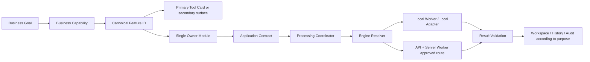
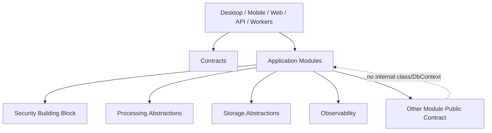
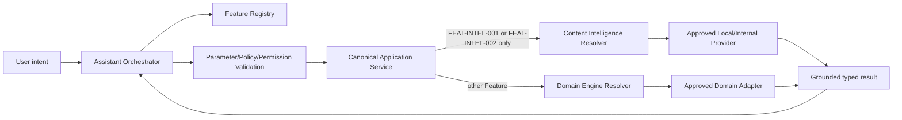

# AGENT A — Business Capability, Application, Module & Component Mapping Report

**Task ID:** `DOC18-AGENT-A`  
**Status:** rekomendasi specialist untuk integrasi; bukan perubahan Document 18 master  
**Baseline canonical:** 550 Feature ID dan 33 Primary Tool Cards  
**Arsitektur yang dipertahankan:** Modular Monolith + Clean Architecture + Separate Deployables; Offline-First; capability-aware Local-First  
**Sumber berwenang yang tersedia:** Documents 01–17 FINAL dan `MASTER_PROJECT_SUMMARY.md` v4.0  
**Deployment baseline:** `docs/17-deployment/17_DEPLOYMENT_GUIDE_FINAL_v1.0_PERTAMINA_OTO.md`; 55/55 keputusan deployment AUTO-LOCKED  
**Register terkait:** Deployment Decision, Environment Configuration, Release Checklist, dan Deployment Runbook registers v1.0

> **Batas readiness:** Document 17 berstatus **FINAL v1.0 — PRE-IMPLEMENTATION DEPLOYMENT BASELINE**, bukan `PRODUCTION_READY`. Ia mengunci logical deployables, artifact/release boundary, environment lanes, compatibility, migration, rollback, observability, dan operational guard. Exact Production topology/hosting/OS/network, SSO, secret/storage product, signing/distribution, capacity/SLA, backup/DR, RC/artifact evidence, dan authority tetap memakai confirmation gates resmi Document 17.

> **Cara membaca:** `Owner` berarti satu pemilik perubahan business rule/data/contract, bukan berarti hanya satu host dapat menjalankan implementasinya. `Primary Tool Card` adalah permukaan UI; satu card dapat menjadi workflow bundle dan tidak otomatis menjadi service, class, endpoint, engine, atau tabel baru.

## 1. System purpose

PERTAMINA OTO menyatukan pengolahan dokumen dan gambar internal ke satu produk yang aman, mudah digunakan, dapat diaudit, dan dapat dialihkelolakan. Nilai bisnis utamanya adalah:

1. mengurangi perpindahan aplikasi dan penggunaan layanan publik untuk dokumen perusahaan;
2. memberi alur File-First, Tool-First, dan Assistant-First yang berakhir pada capability canonical yang sama;
3. menjaga file sumber melalui working state non-destruktif, validasi hasil, Save/Save As, recovery, dan history;
4. mengutamakan pemrosesan lokal yang disetujui serta memakai server hanya ketika capability, policy, keamanan, atau beban memang memerlukannya;
5. memisahkan administrasi, content access, Audit, Support, dan observability;
6. membuat Feature ID, contract, module owner, host, test, manual, dan runbook dapat ditelusuri.

### 1.1 Rantai cartography canonical

```text
Business Goal
→ Business Capability
→ Canonical Feature / workflow bundle
→ Primary Tool Card bila user-facing Core
→ Single owner Module
→ Application component / public contract
→ Host and engine/provider selected by capability/policy
→ Result + History/Audit/telemetry according to purpose
```

### 1.2 Invarian pemetaan

- Business rule tidak ditempatkan di Desktop, Mobile, atau Web UI.
- Feature ID dari Document 03 tidak dibuat, diganti, atau dipecah oleh cartography.
- Setiap canonical Feature mempunyai satu owner module; module lain hanya mengonsumsi contract.
- Assistant mengorkestrasi Feature canonical dan tidak menjadi engine.
- Content Intelligence memiliki provider/resolver sendiri dan tidak dicampur ke Assistant.
- Local-only processing tidak diberi server-processing API.
- Engine/provider adalah dependency di belakang adapter/resolver, bukan owner Feature.
- REST/persisted resource adalah source of truth untuk server; SignalR hanya notifikasi.
- Shared Building Block tidak memiliki business workflow atau mutable business state.
- `CRITICALITY_TBD` adalah placeholder yang harus disetujui, bukan nilai availability/SLA terselubung.

## 2. Actor map

Developer/Maintainer dan Operations/Deployment Function di bawah ini adalah fungsi kerja, bukan role aplikasi baru. Support/Superadmin tetap capability berbasis permission dan bukan akun dengan akses tak terbatas.

| Actor/context | Business goal | Channel | Capability utama | Restricted access | Key workflow |
|---|---|---|---|---|---|
| **User** | Menyelesaikan pekerjaan dokumen/gambar dengan aman dan cepat | Desktop utama; Web; Phone/Tablet terkurasi | Core tools, workspace, history sendiri, secured files sendiri, Assistant, issue reporting | Tidak mengubah policy/user; tidak melihat resource user lain; server action tetap permission/policy-gated | File/Tool/Assistant → validasi → proses → result → Save/Amankan ke Akun |
| **Administrator** | Mengelola account, akses, feature exposure, policy, capacity setting, dan health | Web/admin surface; Desktop bila resmi diekspos | AccountAdministration, configuration/policy, job/health metadata | Tidak otomatis membuka/download dokumen, OCR, prompt, atau signature asset milik user | Cari user → ubah akses/policy → alasan/confirm/reauth → verify effective access → Audit |
| **Auditor** | Memeriksa bukti aktivitas dan kepatuhan | Web/audit surface | Query, view, dan export Audit sesuai permission | Read-only; tidak mengubah account/config/Audit; tidak otomatis membaca content/Support | Filter safe metadata → inspect authorized event → export bounded evidence |
| **Support/Superadmin** | Menerima, mengklasifikasi, dan menindaklanjuti issue | Support console pada Web; report issue dari client | Support triage, internal note, status, export sesuai permission | Bukan formal unlimited role; tidak otomatis mengakses seluruh file/Audit/admin | Issue submitted → safe context → triage → update → export/escalate → close |
| **Developer/Maintainer** | Memperbaiki defect dan memelihara code/contract/test | Azure DevOps/repository dan environment non-Production yang disetujui | Module-scoped development, PoC, test, safe diagnostics | Bukan application content actor; tidak memperoleh Production data/content karena tugas coding | Requirement/Feature → scoped change → tests/security scan → PR/review → release evidence |
| **Operations/Deployment Function** | Menjaga deployment, health, capacity, backup/recovery, dan rollback | Pipeline, approved control plane, monitoring | Deployable/config/artifact operations dan incident recovery | Tidak otomatis memperoleh content/admin/audit permission; tidak direct-patch business data | Approved artifact → deploy → smoke/observe → rollback/recover/escalate |

### 2.1 Actor yang tidak boleh dipalsukan

Jika Assistant menjalankan Merge PDF, actor utama tetap User, `Origin=ASSISTANT`, dan executor adalah application/worker identity yang sebenarnya. Worker, service, atau pipeline tidak menggantikan actor bisnis dan tidak mewarisi permission user di luar job/resource scope.

## 3. Business-capability catalog

### 3.1 Legenda lifecycle

| Label | Arti cartography |
|---|---|
| `FOUNDATION` | Diperlukan agar Core/application boundary dapat berjalan |
| `CORE` | Mendukung satu atau lebih 33 Primary Tool Cards |
| `CORE_POC_GATED` | Core, tetapi capability/provider/fidelity harus melewati PoC |
| `STANDARD_AFTER_CORE` | User-tool sekunder dilanjutkan setelah Core Gate |
| `CONTINUOUS_CONTROL` | Berjalan sepanjang lifecycle operasi/security/support |
| `SELECTIVE` | Hanya setelah pilihan eksplisit/policy/capability yang berlaku |

### 3.2 Katalog capability

| Business capability | Tujuan bisnis | Actor | Requirement utama | Feature canonical | Owner module / collaborator | Client/channel | Criticality | Dependency kunci | Lifecycle |
|---|---|---|---|---|---|---|---|---|---|
| **Document Organization** | Menggabungkan, memisahkan, memilih, mengurutkan, memutar, dan mengelola halaman tanpa merusak sumber | User | `FR-FILE-001..015`; `FR-PROC-001..005`; `NFR-REC-001..003` | `FEAT-PDF-005..019` sesuai capability; Core #1–5, #20, #23 | **Pdf**; Workspace untuk working state | Desktop full; Phone/Tablet curated; Web hanya browser-safe | `CRITICALITY_TBD` | Feature Registry, PDF engine, Workspace, Result Validation | `CORE`; sisanya `STANDARD_AFTER_CORE` |
| **PDF Optimization** | Mengurangi ukuran, memperbaiki, dan mengoptimalkan PDF dengan hasil tervalidasi | User | `FR-PROC-001..005`; `NFR-PERF-003,007..010`; `NFR-REC-001..003` | `FEAT-PDF-023..030`; Core #7–9 melalui OCR collaborator | **Pdf**; ScannerOcr untuk OCR | Desktop; curated client; Web/server route conditional | `CRITICALITY_TBD` | PDF/OCR resolver, quarantine, capacity | `CORE` / `CORE_POC_GATED` |
| **Document Conversion** | Mengubah format dokumen, PDF, gambar, teks, web, dan data dengan fidelity yang dapat diuji | User | `FR-PROC-001..005`; `BR-GOV-006..009`; `NFR-PERF-007..010` | `FEAT-CONV-001..036`; Core #10–18 dan #33 | **Conversion**; Image/Pdf/ScannerOcr/ContentIntelligence sebagai contract consumer/provider | Desktop primary; Web conditional; Mobile curated | `CRITICALITY_TBD` | Conversion engine, Engine Resolver, active-content guard | `CORE`, banyak `CORE_POC_GATED`; sisanya `STANDARD_AFTER_CORE` |
| **PDF Editing** | Mengubah working copy, annotation/form/layout, lalu finalisasi secara non-destruktif | User | `FR-STOR-001..006`; `FR-UI-020..021`; `FR-VER-004`; `SR-SEC-023` | `FEAT-PDF-031..060`; Core #21–25 | **Pdf**; Workspace dan SignatureAnnotation | Desktop full; Tablet richer curated; Phone limited; Web conditional | `CRITICALITY_TBD` | Operation log, autosave, PDF engine, confirmation/result validation | `CORE`; existing-text `CORE_POC_GATED` |
| **PDF Security** | Melindungi, membuka secara sah, meredaksi, dan memeriksa PDF dengan finalization guard | User | `SR-SEC-003,011..012,022..023`; `FR-SIGN-001..003` | `FEAT-PDF-061..070`; `FEAT-SIGN-013`; Compare `FEAT-PDF-071 / FEAT-PDF-072` | **Pdf**; SignatureAnnotation untuk visual sign | Desktop primary; curated Mobile/Tablet; Web hanya approved route | `CRITICALITY_TBD` | Authorization, reauth/confirmation, password memory boundary, forensic validation | `CORE`; high-risk continuous security control |
| **PDF Intelligence** | Ringkasan, terjemahan, dan Markdown yang grounded tanpa public AI | User; Assistant as origin | `FR-INTEL-001..003`; `SR-SEC-013..021`; `IR-API-009..010` | `FEAT-INTEL-001..002`; `FEAT-CONV-036` | **ContentIntelligence** untuk INTEL; **Conversion** untuk Markdown; Assistant hanya orchestrator | Desktop; Web/Phone/Tablet hanya jika registry expose | `CRITICALITY_TBD` | Approved provider, data minimization, PDF extraction/OCR, policy | `CORE_POC_GATED` |
| **Image Processing** | Mengolah, mengonversi, membandingkan, dan memberi anotasi pada gambar | User | `FR-FILE-*`; `FR-PROC-*`; `UIR-UI-006..010` | `FEAT-IMG-001..048` | **Image**; SignatureAnnotation untuk signature/annotation contract bila berlaku | Desktop full; Mobile/Tablet curated; Web browser-safe conditional | `CRITICALITY_TBD` | Image engine; optional approved ML provider | `STANDARD_AFTER_CORE`, kecuali dependency Core JPG/PDF |
| **Scanner/OCR** | Menangkap dokumen dan menghasilkan gambar, teks, tabel, atau searchable PDF | User | `FR-SCAN-001..002`; `FR-PROC-*`; `SR-SEC-014,021` | `FEAT-SCAN-001..018`; `FEAT-OCR-001..013`; Core `FEAT-SCAN-014`, `FEAT-OCR-004` | **ScannerOcr**; Pdf/Conversion consume output | Phone/Tablet camera-first; Desktop import/physical scanner conditional; Web conditional | `CRITICALITY_TBD` | Device adapter/consent, OCR engine, resource/capability check | Core items `CORE_POC_GATED`; remainder `STANDARD_AFTER_CORE` |
| **Visual Signature/Annotation** | Membuat/mengelola aset visual lokal dan menerapkan tanda tangan/paraf non-PKI atau anotasi | User | `FR-SIGN-001..003`; `BR-SIGN-001`; `SR-SEC-011..012` | `FEAT-SIGN-001..013`; `FEAT-ANN-001..014` | **SignatureAnnotation**; Pdf/Image consume placement contract | Mobile/Tablet natural; Desktop full; Web conditional | `CRITICALITY_TBD` | Protected asset store, platform input, PDF/Image engine | Core `FEAT-SIGN-013`; lainnya `STANDARD_AFTER_CORE` |
| **Workspace/Recovery** | Menjaga draft, working state, progress, local/server job, retry/resume, result, dan source safety | User; System/Worker | `FR-STOR-*`; `FR-REC-*`; `FR-UI-020..021`; `NFR-REC-*` | `FEAT-EDIT-*`, `FEAT-PROC-*`, `FEAT-STOR-*`, `FEAT-VALID-*`, `FEAT-REC-*`, `FEAT-PROG-*`, serta bagian `FEAT-HIST-*`, `FEAT-TRASH-*`, `FEAT-VER-*`, dan `FEAT-BACKUP-*` | **Workspace**; all processing modules consume contracts | Desktop primary; curated Mobile; Web server-resource subset | `CRITICALITY_TBD` | Local filesystem/SQLite, jobs, Local/Server Worker, storage abstraction | `FOUNDATION` + `CONTINUOUS_CONTROL` |
| **Account/Administration** | Memelihara principal, session, role/permission assignment, effective access, dan admin controls | User/Admin | `FR-AUTH-001..005`; `FR-ROLE-001..003`; `SR-SEC-*` | `FEAT-AUTH-001..012`; `FEAT-ADMIN-001..022`; security surface `FEAT-SEC-*` | **AccountAdministration**; Security Building Block | Web/admin primary; client account/session surface | `CRITICALITY_TBD` | Pertamina SSO, Authorization Service, Audit | `FOUNDATION` + `CONTINUOUS_CONTROL` |
| **Secured File/Sync** | Menyimpan file/result yang dipilih user, maksimum tiga versi, dan akses lintas perangkat terkontrol | User; Admin metadata-only | `FR-BACKUP-001..010`; `FR-VER-001..004`; `DR-DB-003..005` | `FEAT-BACKUP-001..016`; `FEAT-VER-001..006`; relevant `FEAT-TRASH-*` | **Workspace** sebagai rekomendasi anchor; Secured Files data boundary Document 07 | Desktop/Mobile/Web account channel | `CRITICALITY_TBD` | API, SQL metadata, Secure Storage, ownership/reauth, explicit transfer | `SELECTIVE` + `CONTINUOUS_CONTROL` |
| **Audit** | Menyediakan bukti enterprise yang aman, append-oriented, dapat dicari dan diekspor | Auditor; privileged administrators by permission | `FR-AUDIT-001..004`; `DR-DB-006`; Document 10 | `FEAT-AUDIT-001..008`; event dari Feature lain | **Audit** | Web audit surface; client offline outbox; API/Worker ingest/export | `CRITICALITY_TBD` | Safe AuditIntent/outbox, authorization, SQL, clock | `FOUNDATION` + `CONTINUOUS_CONTROL` |
| **Support/Issue Reporting** | Memberi intake ringan, triage, komunikasi, export, dan handoff incident | User; Support | `FR-SUP-001..007`; `SR-SEC-019..020`; `DR-DB-007` | `FEAT-SUPPORT-001..008` | **Support** | Report dari Desktop/Mobile/Web; Web Support console | `CRITICALITY_TBD` | Safe diagnostics, secure attachment storage, Audit, Issue API | `FOUNDATION` + `CONTINUOUS_CONTROL` |
| **Assistant/Orchestration** | Menemukan tool, memvalidasi intent/parameter, menyusun plan, dan memanggil capability resmi | User; Assistant origin | `FR-ASSIST-001..015`; `SR-SEC-013..018`; `IR-API-010` | `FEAT-ASSIST-001..030`; mengacu Feature canonical lain | **Assistant** | Desktop primary; curated Mobile/Web | `CRITICALITY_TBD` | Feature Registry, Authorization, Processing Coordinator, application services | `FOUNDATION`; user workflows selective |
| **Observability** | Menghubungkan health, log, trace, metric, alert, dan correlation tanpa content | Operations; Admin/support sesuai permission | `NFR-MON-001..004`; `SR-SEC-004`; `NFR-PERF-*` | `FEAT-MON-001..017` | **AccountAdministration operations surface** + Observability Building Block; owner perlu konfirmasi | Admin/operations channels; instrumentation pada semua host | `CRITICALITY_TBD` | OpenTelemetry/logging/APM, safe fields, clock, host health | `CONTINUOUS_CONTROL` |
| **Configuration/Policy** | Mengontrol Feature snapshot, exposure, flag, policy, compatibility, limit, dan rollout | Administrator | `BR-GOV-*`; `FR-ROLE-*`; `NFR-PERF-007..013`; Documents 06/08/15 | relevant `FEAT-ADMIN-*`, `FEAT-SEC-*`, registry metadata | **AccountAdministration configuration slice** sebagai rekomendasi; Security Building Block enforces | Web Admin/API; read projection ke clients/workers | `CRITICALITY_TBD` | Typed/versioned config, policy precedence, Audit, compatibility | `FOUNDATION` + `CONTINUOUS_CONTROL` |

### 3.3 Guard capability ownership

Capability yang melibatkan lebih dari satu module tetap mempunyai satu owner per Feature. Contoh: OCR PDF tetap canonical `FEAT-OCR-004` milik ScannerOcr; Pdf mengonsumsi `IOcrCapability` dan menyusun output PDF. `FEAT-CONV-036` tetap milik Conversion walaupun dapat memakai OCR atau Content Intelligence provider yang disetujui.

## 4. Channel/platform map

### 4.1 Legenda exposure

| Kode | Arti |
|---|---|
| `FULL` | Kanal utama/full-feature untuk capability tersebut |
| `CURATED` | Subset yang berguna dan telah diekspos registry; bukan parity |
| `SERVER/WEB` | Browser-safe atau server-backed setelah capability/policy check |
| `ADMIN` | Permukaan administratif/operasional sesuai permission |
| `CONTRACT` | Tidak ada UI utama; hanya contract/status/projection yang diperlukan |
| `—` | Tidak dijanjikan pada baseline |

### 4.2 Pemetaan capability exposure

| Capability | Desktop | Web | Phone | Tablet | Guard |
|---|---|---|---|---|---|
| Document Organization | `FULL` | `SERVER/WEB` conditional | `CURATED` sederhana | `CURATED` lebih kaya | Platform exposure + device resource + engine |
| PDF Optimization | `FULL` | `SERVER/WEB` conditional | `CURATED` | `CURATED` | Large/complex route tidak diasumsikan tersedia |
| Document Conversion | `FULL` | `SERVER/WEB` conditional | `CURATED` format praktis | `CURATED` | Office/complex conversion PoC dan server policy |
| PDF Editing | `FULL` | `SERVER/WEB` subset | `CURATED` ringan | `CURATED` lebih kaya | Existing-text editing tetap gated |
| PDF Security | `FULL` | conditional | `CURATED` yang aman | `CURATED` | Unlock/Protect/Redact/Sign memiliki gate khusus |
| PDF Intelligence | exposed setelah PoC | `SERVER/WEB` approved | `CURATED` bila registry expose | `CURATED` bila registry expose | No public AI; data minimization/consent |
| Image Processing | `FULL` | browser-safe subset | `CURATED` camera/share | `CURATED` lebih kaya | ML bukan default |
| Scanner/OCR | import/OCR full; physical scanner gated | upload/server OCR conditional | camera-first `CURATED` | camera/stylus `CURATED` | Device permission/capability |
| Visual Signature/Annotation | `FULL` | conditional | touch `CURATED` | stylus/touch `CURATED` | Visual non-PKI; asset lokal terlindungi |
| Workspace/Recovery | `FULL` local workspace | server job/result subset | local curated | local curated lebih kaya | Tidak ada full cloud workspace baseline |
| Account/Secured Files/History | account + local | `SERVER/WEB` | `CURATED` | `CURATED` | Ownership/current authorization |
| Administration | optional approved admin client | `ADMIN` primary | — | optional `ADMIN` only if approved | Tidak membuka content access |
| Audit | offline outbox/limited user info | `ADMIN` auditor surface | — | — | Permission dan export gate |
| Support | issue report | issue report + `ADMIN` Support console | issue report | issue report | Attachment hanya explicit send |
| Assistant | `FULL` available capability set | curated browser capability | `CURATED` | `CURATED` richer | Assistant never expands exposure |
| Observability/Configuration | `CONTRACT` safe client state | `ADMIN` | `CONTRACT` | `CONTRACT` | Detail health/config dibatasi |

Availability efektif selalu dihitung sebagai:

```text
Canonical Feature exists
AND release/Feature flag enabled
AND platform exposure allows
AND app/API/contract/capability versions compatible
AND device/engine/provider available
AND permission/ownership/policy allows
AND connectivity/capacity supports selected route
```

UI harus menyembunyikan atau menjelaskan capability yang tidak tersedia; tabel ini tidak mengotorisasi exposure baru.

## 5. Module catalog

### 5.1 Responsibility, capability, features, dan data

Pemetaan prefix pada tabel ini adalah rekomendasi single-owner untuk cartography 550. Empat boundary Document 07—Processing/Jobs, Secured Files, History, dan Platform Configuration—belum muncul sebagai module top-level pada tree Document 04. Laporan ini mengaitkannya ke module yang sudah ada tanpa membuat module baru; keputusan anchor final tetap confirmation gap.

| Module | Responsibility / business capability | Owned canonical feature | Owned data/state | Bukan tanggung jawab |
|---|---|---|---|---|
| **Pdf** | Page operations, PDF optimization/edit/forms/security/compare/conformance | `FEAT-PDF-001..075` (75) | PDF domain state in working artifact; no document BLOB SQL | OCR engine, conversion provider, signature asset, account policy |
| **Conversion** | Format conversion dan deterministic PDF-to-Markdown | `FEAT-CONV-001..036` (36) | Conversion parameters/result manifest; job metadata melalui owner job boundary | Office vendor selection in UI; AI orchestration |
| **Image** | Deterministic image operations dan approved specialized image provider | `FEAT-IMG-001..048` (48) | Local image working artifacts/metadata | Signature ownership, generic workspace, scanner lifecycle |
| **ScannerOcr** | Camera/scanner acquisition, preprocessing, OCR/searchable PDF/text/table capability | `FEAT-SCAN-001..018`; `FEAT-OCR-001..013` (31) | Capture/OCR working artifacts; safe operation metadata | PDF editing, provider routing by UI, permanent OCR content in logs/SQL |
| **SignatureAnnotation** | Protected visual signature/paraf non-PKI and annotation capability | `FEAT-SIGN-001..013`; `FEAT-ANN-001..014` (27) | Protected local asset references and placement state; no server asset default | PKI digital signature; generic PDF editing engine |
| **FileProductivity** | Input/output utilities, productivity actions, discovery, smart workflow metadata, shared UX capability | `FEAT-FILE-001..010`; `FEAT-INPUT-001..021`; `FEAT-PROD-001..018`; `FEAT-FLOW-001..010`; `FEAT-UX-001..018` (77) | Recent/favorite/preset/preference metadata only where assigned | Working document state, Assistant reasoning, feature registry mutation |
| **Workspace** | Working state, validation, execution coordination, progress, recovery, history/secured interaction | `FEAT-EDIT-*`, `FEAT-PROC-*`, `FEAT-PROG-*`, `FEAT-STOR-*`, `FEAT-VALID-*`, `FEAT-BACKUP-*`, `FEAT-HIST-*`, `FEAT-TRASH-*`, `FEAT-REC-*`, `FEAT-VER-*` (134) | SQLite workspace/job/history; proposed anchor for `jobs`, `secured`, `history` server contracts; file bytes in local/secure storage | Engine business logic; Audit table; account authorization |
| **AccountAdministration** | Identity/account/admin/security surface, configuration/policy, monitoring/admin projection | `FEAT-AUTH-001..012`; `FEAT-ADMIN-001..022`; `FEAT-SEC-001..023`; `FEAT-MON-001..017` (74) | `identity`, `admin`, proposed `configuration`; safe monitoring projections only | User content; Audit write model; raw telemetry ownership |
| **Audit** | Audit intent validation, ingestion, append-only evidence, query/export | `FEAT-AUDIT-001..008` (8) | `audit.*`; local encrypted `audit_outbox` contract | History, logs/APM, Support message, document content |
| **Support** | Issue intake, attachment metadata, triage/status/note/export | `FEAT-SUPPORT-001..008` (8) | `support.*`; secure issue attachment/export objects | Incident authorization expansion; arbitrary diagnostic/content collection |
| **Assistant** | Intent/alias resolution, plan validation, canonical orchestration, grounded response | `FEAT-ASSIST-001..030` (30) | minimal local conversation/workflow state; `assistant.*` safe metadata | PDF/OCR/AI engine; direct SQL/filesystem/shell/API; Feature invention |
| **ContentIntelligence** | Summarization/translation application capability dan provider resolution | `FEAT-INTEL-001..002` (2) | `intelligence.*` safe operation/stage metadata; no prompt/document/output | Assistant conversation, public AI, PDF-to-Markdown ownership |

Total: **550** unique canonical Feature ID; tidak ada prefix yang dimiliki dua module pada proposal ini.

### 5.2 Contract, dependency, runtime, test, dan lifecycle

`Owner placeholder` belum menetapkan nama orang/unit Pertamina.

| Module | Public contracts | Consumed contracts | Internal event penting | Engine/provider | Host usage / mode | Test & runbook | Lifecycle / owner placeholder |
|---|---|---|---|---|---|---|---|
| Pdf | Typed Feature handlers; PDF capability application interface; result manifest | Workspace, Processing, Storage, OCR, Signature, Authorization | Feature accepted/completed/failed; result finalized | PDF adapter + Engine Resolver | Desktop/Local Worker primary; API/Worker optional subset; local-first | Unit family Page/Edit/Security; Test Plan §§17–18; `RB-DATA-INTEGRITY-001`, `RB-MALICIOUS-DOC-001`, `RB-REDACTION-001` | Core + standard; `OWNER_PDF_TBD` |
| Conversion | Conversion application contract; typed conversion schema | Workspace, PDF/Image/OCR, Authorization, Processing | Conversion accepted/completed/failed | Conversion adapter + Resolver | Desktop/Local Worker; API/Worker optional | Conversion unit family; Test Plan §§17,19,23–28; Guide16 §48; data-integrity runbook | Core/PoC + standard; `OWNER_CONVERSION_TBD` |
| Image | Image processing contract | Workspace, Storage, Signature, Authorization | Image result finalized/failed | Deterministic image adapter; approved ML only when needed | Desktop/Mobile; Local Worker for heavy; server optional only if registry says | Image family; Test Plan functional/platform/security; data-integrity runbook | Standard after Core except dependency; `OWNER_IMAGE_TBD` |
| ScannerOcr | Scan/OCR capability; searchable PDF/text/table result | Device adapter, Workspace, Storage, Authorization | Capture/OCR accepted/completed/failed | Scanner/device adapters; OCR adapter + Resolver | Mobile camera; Desktop import; Local Worker; approved server fallback | OCR/adapter tests; Test Plan §§17,19,27; Guide16 §49; Local Worker/data-integrity runbook | Core/PoC + standard; `OWNER_SCANNER_OCR_TBD` |
| SignatureAnnotation | Signature asset/placement and annotation contract | Workspace, Storage, Pdf/Image, Authorization | Visual sign finalized/failed; asset lifecycle safe event | Platform drawing/input + PDF/Image adapter | Mobile/Tablet + Desktop; local baseline | Signature/security tests; UAT §§23–24; `RB-DATA-INTEGRITY-001`; security process | Core + standard; `OWNER_SIGNATURE_TBD` |
| FileProductivity | File input/output, discovery, preference/preset contracts | Feature Registry, Workspace, Storage, platform adapters | Input selected/validated; preference/preset changed where auditable | Platform file/share/clipboard/print adapters | Mostly client hosts; API for approved account metadata | Validation/platform tests; Test Plan §§20–22,38; User Manual §§13–17 | Foundation + standard; `OWNER_PRODUCTIVITY_TBD` |
| Workspace | Workspace, job, progress, recovery, history, secured-file application contracts | All processing modules, Storage/Processing abstractions, Authorization, Audit | Job state/result/checkpoint; history projection; secured lifecycle | No domain engine; coordinates selected adapter/worker | Desktop/Mobile; API; Local/Server Worker integration | Unit state/recovery/resolver; Test Plan §§26–28,35–37; Local Worker/Storage/Data Integrity runbooks | Foundation/continuous; `OWNER_WORKSPACE_TBD` |
| AccountAdministration | Account/admin/config/policy/compatibility/health resource contracts | Pertamina identity, Security, Observability, Audit | Account/access/policy/config changed; session revoked | No document engine | Web/API primary; safe projections to clients/workers | Authorization/config tests; UAT §§29–32; Admin Manual §§7–34,43–49; SSO/API runbooks | Foundation/continuous; `OWNER_IAM_ADMIN_TBD` |
| Audit | AuditIntent/batch/query/export contracts | Actor/context from modules, Security, Storage, Processing | Audit intent accepted/persisted/exported | No processing engine; export generator only | Client outbox; API ingest/query; Worker export | Audit mapping/security tests; Test Plan audit/DB/storage; `RB-AUDIT-FAIL-001` | Foundation/continuous; `OWNER_AUDIT_TBD` |
| Support | Issue/report/triage/status/export contracts | Security, Storage, Observability safe context, Audit | Issue submitted/triaged/status/exported | Screenshot markup is client adapter; export generator | All client report surfaces; Web/API; Worker export | Support tests/UAT §§33–34; User Manual §42; Admin Manual §§35–39; `RB-ISSUE-001` | Foundation/continuous; `OWNER_SUPPORT_TBD` |
| Assistant | Intent/plan/invocation and grounded result contracts | Feature Registry, Authorization, all module application contracts, Processing | Workflow validated/delegated/blocked | Optional local/internal reasoning provider only for orchestration; never tool engine | Desktop primary; Mobile/Web curated; API only approved server orchestration | Assistant unit/security tests; Test Plan business/AI; UAT §16; User Manual §37 | Foundation/selective; `OWNER_ASSISTANT_TBD` |
| ContentIntelligence | `IContentIntelligenceProvider`-style application/provider boundary; result provenance | PDF extraction/OCR, Workspace, Security/Policy, Processing | Provider transfer authorized; intelligence completed/denied | Approved local or enterprise-internal provider + resolver | Desktop/Local Worker or API/Server Worker according to approved route | Intelligence/provider PoC; Test Plan §§17,19,29–35; `RB-AI-PROVIDER-001` | Core PoC-gated; `OWNER_INTELLIGENCE_TBD` |

### 5.3 Dependency direction

```text
Hosts/UI
  ↓ only public application/contracts
Modules (single business owner)
  ↓ ports/abstractions
Building Blocks
  ↓ adapters
Approved platform/engine/storage/identity/observability technology
```

Forbidden dependency examples:

- Pdf referencing ScannerOcr infrastructure class or its DbContext;
- Assistant referencing a PDF engine/provider directly;
- ContentIntelligence calling Assistant to execute a model;
- FileProductivity writing Workspace SQLite tables directly;
- UI reconstructing permission, processing route, or state-transition business rules;
- any module writing another module/schema data directly.

## 6. Building Blocks map

Building Blocks are stable technical primitives. They must remain small, versioned, and free of business workflow/state.

| Building Block | Purpose | Allowed consumers | Forbidden dependency/content | Versioning | Ownership | Tests |
|---|---|---|---|---|---|---|
| **Contracts** | Canonical IDs, typed/versioned request/result/error/event/compatibility contracts and neutral primitives | Hosts and all Modules through explicitly referenced packages | Domain service implementation, UI type, ORM entity, vendor SDK, mutable registry database, secrets | Semantic/contract version; breaking change follows API/local IPC compatibility policy | `OWNER_SHARED_CONTRACTS_TBD`; reviewed by affected module owners | Serialization, schema, compatibility, OpenAPI/IPC snapshot, forbidden-reference tests |
| **Security** | Authentication/authorization context, policy evaluation interfaces, secure redaction helpers, identity/workload primitives | Hosts/modules needing enforcement | Role-specific business shortcuts, content access grant, SSO vendor invention, token/password persistence | Security contract/policy version; deny on unsupported sensitive state | `OWNER_SECURITY_TBD` | Policy/resource authorization, stale/offline/reauth, negative security/privacy tests |
| **Observability** | Structured log/trace/metric/correlation abstractions and safe field policy | All hosts/modules | Document/OCR/prompt/token/secret/signature content; business state source; Enterprise Audit implementation | Telemetry schema/version and backward-compatible collector contract | `OWNER_OBSERVABILITY_TBD` | Sensitive-data canary, correlation propagation, failure/no-op safety, schema tests |
| **Storage.Abstractions** | Opaque local/secure object/file operations, atomic promote, digest, lifecycle interfaces | Workspace and module infrastructure adapters | Physical path/storage key as business authority; SQL entity; cross-owner delete; provider-specific types in domain | Contract version; object metadata/state migrations governed separately | `OWNER_STORAGE_ABSTRACTIONS_TBD` | Path/reference boundary, atomicity, cleanup/idempotency, fault/security tests |
| **Processing.Abstractions** | Job/result/progress/cancellation/checkpoint/engine/provider ports and workload primitives | Processing modules, Workspace, API/Workers/Local Worker | Feature-specific business branching, queue implementation leakage, arbitrary command/shell/URL, vendor types | Contract + CapabilityVersion + parameter/result schema versions | `OWNER_PROCESSING_ABSTRACTIONS_TBD` | State machine, cancellation/retry/idempotency, resolver contract, IPC/Worker contract tests |

### 6.1 Anti-dumping-ground gate

A type may enter a Building Block only if at least two legitimate consumers need the same stable, domain-neutral abstraction and no existing owner module can own it. A shared type requires owner, rationale, compatibility rule, tests, and forbidden-dependency check. Convenience alone is insufficient.

## 7. Component catalog proposal

Komponen berikut adalah boundary logis yang didukung dokumen; bukan daftar class, microservice, endpoint, atau deployment unit baru.

| Logical component | Owner boundary | Responsibility | Primary/secondary host | Public/shared boundary | Explicit non-responsibility |
|---|---|---|---|---|---|
| **Feature Registry** | Configuration slice; module anchor to confirm | Memuat 550 Feature definitions, aliases, schemas, exposure, risk, processing and capability metadata | API/client projection; all hosts consume | Typed registry snapshot/query | Tidak mengeksekusi Feature atau menyimpan UI state |
| **Processing Coordinator** | Workspace/Processing boundary; anchor to confirm | Preflight, route immediate/background and local/server, create/reconcile Job, cancellation/retry/recovery | Desktop/API primary; Local/Server Worker consume work | Processing abstractions and Job contract | Tidak memilih vendor from UI atau menjalankan engine logic sendiri |
| **Engine Resolver** | Processing abstraction with module adapters | Memilih approved adapter berdasarkan capability/platform/policy/resource/offline/server state | Desktop/API/Workers | Resolver request/result | Tidak mengubah permission/policy atau menjadi provider |
| **PDF Application Service** | Pdf | Orkestrasi page/edit/forms/security/conformance use case | Desktop/API; workers execute adapter step | Pdf application contract | Bukan satu class besar; capability families tetap terpisah internal |
| **Conversion Application Service** | Conversion | Validasi source/target/options and coordinate conversion result | Desktop/API; workers | Conversion contract/schema | Tidak mengotomatiskan Office Desktop sebagai fondasi atau memilih vendor di UI |
| **Image Application Service** | Image | Deterministic image operations and approved specialized provider routing | Desktop/Mobile/API; Local Worker optional | Image processing contract | Tidak mengambil alih signature/scanner/workspace |
| **Scanner/OCR Application Service** | ScannerOcr | Device capture lifecycle, preprocessing, OCR, searchable output | Mobile/Desktop/API; workers | Scan/OCR capability contract | Tidak menyimpan full OCR text in telemetry/SQL |
| **Signature/Annotation Application Service** | SignatureAnnotation | Aset visual lokal, drawing/placement, annotation, non-PKI finalization | Mobile/Tablet/Desktop | Signature/annotation contract | Tidak mengklaim certificate/PKI signing |
| **Workspace Service** | Workspace | Working state, operation log, autosave/checkpoint, source/result references | Desktop/Mobile; Web subset through API | Workspace/recovery contracts | Tidak full-cloud-sync draft/cache/undo/temp |
| **Local Job Coordinator** | Workspace/Processing | Authoritative local job lifecycle and typed IPC to isolated Local Worker | Desktop/Mobile client and Local Worker | Local IPC contract | Tidak menjadi server queue dan tidak expose network endpoint |
| **Server Job Service** | Processing/Jobs data boundary; module anchor to confirm | Persisted Job/upload/idempotency/admission/outbox/REST authority | API + Server Worker | Job/resource API and internal work contract | SignalR is not state authority; no arbitrary job payload |
| **Secured File Service** | Secured Files data boundary; proposed Workspace anchor | Explicit Amankan ke Akun, version/recycle/retrieve lifecycle | API/Worker; clients consume | Secured-file resource contract | Tidak generic workspace sync; no automatic admin content access |
| **Issue Reporting Service** | Support | Minimal submit, explicit attachment, triage/status/note/export | All clients, API, Web Support, Worker export | Issue resource contract | Tidak collect raw/unbounded diagnostics or assign user severity |
| **Audit Service** | Audit | Validate/persist/query/export safe enterprise evidence | Client outbox, API, Worker | AuditIntent/batch/query/export | Bukan History/logging; no content payload |
| **Authorization Service** | Security Building Block + AccountAdministration policy sources | Evaluate subject, permission, ownership, scope, resource state, policy, reauth | Every trust boundary; API final authority | Authorization context/policy interface | Tidak `if role == Admin`; no implicit content access |
| **Assistant Orchestrator** | Assistant | Resolve intent to canonical Feature, validate plan/parameters, delegate, ground result | Desktop/Mobile/Web/API as exposed | Assistant plan/invocation contract | Bukan engine, arbitrary agent, direct SQL/shell/filesystem/API |
| **Content Intelligence Resolver** | ContentIntelligence | Pilih local/internal approved provider and enforce minimization/route/fallback | Desktop/Local Worker/API/Worker | Provider abstraction and provenance result | Tidak berada di Assistant; no public fallback |
| **Result Validation Service** | Pattern owned per producing module; shared primitives only | Validate type, structure, digest/count/conformance and promote temporary result atomically | Client/Workers | Result validation primitives/manifest | Bukan satu universal validator dengan semua business rules |
| **Progress/Activity Service** | Workspace | Aggregate persisted/local Job state into user-visible progress/activity and REST reconciliation | Desktop/Mobile/Web/API; SignalR notification | Job progress/activity query + event envelope | Tidak menciptakan state baru dari SignalR atau mengaudit progress persen |

### 7.1 Component size rules

- `PDF Application Service` adalah façade konseptual, bukan satu god class; handler/capability internal dikelompokkan berdasarkan page operations, editing/forms, optimization, security, and conformance.
- `Result Validation` menggunakan primitive bersama, tetapi aturan “valid PDF/A”, “valid OCR result”, atau “redaction removed” tetap milik module penghasil.
- Local Job Coordinator dan Server Job Service berbagi contract concepts, bukan database atau queue state.
- Feature Registry menyajikan metadata; Configuration/Policy mengatur exposure/limit; Authorization membuat keputusan; ketiganya tidak boleh dilebur menjadi shared mutable singleton.

## 8. Host-to-module matrix

### 8.1 Legenda

| Kode | Arti |
|---|---|
| `P` | Primary host untuk logic/runtime facet module |
| `S` | Secondary/curated/optional execution or presentation adapter |
| `C` | Shared contract/projection only; business implementation tidak dideploy penuh |
| `—` | Not deployed pada baseline |

Satu module dapat memiliki `P` pada client dan Worker karena application boundary serta engine adapter dieksekusi pada proses berbeda; ini tidak berarti duplicate owner/business rule.

| Module | Desktop | Mobile | Web | API | Server Worker | Local Worker | Catatan |
|---|:---:|:---:|:---:|:---:|:---:|:---:|---|
| Pdf | `P` | `S` | `S` | `S` | `S` | `P` | Local-first; Web/API/Worker hanya approved optional subset |
| Conversion | `P` | `S` | `S` | `S` | `P` | `P` | Server provider conditional; local provider capability-aware |
| Image | `P` | `P` | `S` | `S` | `S` | `P` | Mobile camera/image natural; ML special provider gated |
| ScannerOcr | `S` | `P` | `S` | `S` | `P` | `P` | Device capture in client; OCR may execute worker |
| SignatureAnnotation | `P` | `P` | `S` | `C` | `—` | `S` | Visual asset local by default; final PDF adapter local |
| FileProductivity | `P` | `S` | `S` | `S` | `C` | `C` | Platform input/output adapters remain host-specific |
| Workspace | `P` | `P` | `S` | `P` | `S` | `P` | Local workspace differs from server resource/job facets |
| AccountAdministration | `S` | `S` | `P` | `P` | `C` | `C` | API final authorization; admin UI primarily Web |
| Audit | `C` | `C` | `S` | `P` | `S` | `C` | Clients only safe outbox/status; Web Auditor UI |
| Support | `S` | `S` | `P` | `P` | `S` | `—` | All clients can report; Web hosts console |
| Assistant | `P` | `S` | `S` | `S` | `C` | `C` | Underlying Feature executes in owner module/worker |
| ContentIntelligence | `S` | `S` | `S` | `P` | `P` | `P` | Exact host follows approved provider/capability route |

### 8.2 Host guard

- **Desktop:** full productivity UI, local application composition, protected workspace, SQLite, and Local Worker client.
- **Mobile:** curated application composition and platform adapters; not Desktop parity.
- **Web:** presentation host and enterprise/admin/browser channel; no SQL or module-internal infrastructure access.
- **API:** server security/resource/contract boundary and final server authorization.
- **Server Worker:** job-scoped internal execution identity; no user token reuse and no public endpoint.
- **Local Worker:** isolated local engine execution via typed/versioned IPC; no network by default and no server authority.

Physical co-hosting does not change this logical placement. Document 17 FINAL mengunci Web, API, Server Worker, Desktop, Mobile/Tablet, Local Worker, SQL Server, Secure File/Object Storage, Monitoring/Telemetry, dan SQLite local state sebagai logical deployables/boundaries yang distinct. Web, API, Server Worker, Desktop, Local Worker, Mobile, migration bundle, configuration template, OpenAPI, SBOM/evidence, dan Release Manifest dipaketkan sebagai artifact/release units yang dapat ditelusuri. Desktop dan Local Worker menjadi satu signed compatibility cohort secara default, tetapi tetap process/artifact/version boundary terpisah. Exact Production physical topology tetap `REQUIRES_PERTAMINA_INFRASTRUCTURE_CONFIRMATION`.

### 8.3 Module-to-artifact guard from Document 17

Module, component, host, artifact, process, dan physical node adalah dimensi berbeda. Exact project/assembly composition baru menjadi evidence ketika Release Manifest implementasi tersedia.

| Document 17 release unit | Cartography composition rule | Version/evidence link | Forbidden assumption |
|---|---|---|---|
| **Web artifact** | Presentation/composition untuk browser capability dan public application contracts | Product/Build/Commit, config, compatibility, artifact digest | Web owns domain rules or accesses SQL/module infrastructure |
| **API artifact** | Server composition root; exposes governed resource/Feature contracts and final authorization | API `ContractVersion`, `CapabilityVersion`, config/schema compatibility | Every module becomes an endpoint or API is a processing engine |
| **Server Worker artifact** | Closed set of approved Feature handlers/adapters for persisted jobs | Worker/handler/engine/schema versions, Job compatibility, digest | Arbitrary handler/plugin, user-token reuse, or public endpoint |
| **Desktop artifact** | WinUI client composition, shared application contracts, protected local profile/workspace | `DesktopVersion`, `LocalSchemaVersion`, supported API/`CapabilityVersion` | Desktop bypasses API for server resources or embeds server identity |
| **Local Worker artifact** | Isolated local execution for a closed operation set via versioned IPC | `LocalWorkerVersion`, `IpcContractVersion`, engine/handler versions; signed Desktop cohort | In-process equivalence, arbitrary network/filesystem/SQL/shell |
| **Mobile artifact** | MAUI curated client composition and platform adapters | `MobileVersion`, `LocalSchemaVersion`, exposure/capability/config | Desktop parity or direct SQL/storage access |
| **Database Migration Bundle** | Ordered module/schema/DbContext-owned migrations from the same release commit | `DatabaseMigrationVersion`, digest, target compatibility, recovery evidence | Startup migration, cross-module table change, automatic destructive rollback |
| **Configuration Template** | Typed schema/default/reference model; environment/policy/flag supplied separately | `ConfigurationVersion` and validation/rollback evidence | Secret, Production value, or business/authorization override in artifact |
| **OpenAPI artifact** | Generated/versioned server contract snapshot | `ContractVersion`/API major and breaking-change evidence | Manual API document as implementation source |
| **SBOM/Test/Security Evidence** | Supply-chain and gate evidence linked to exact bytes | Artifact ID/digest, scanner/test result, and waiver status | Evidence contains content/secret or turns `BLOCKED` into `PASS` |
| **Release Manifest** | Authoritative release composition linking all artifact/version/config/schema combinations | Release/Build/Commit/PR/Feature and promotion history | Cartography alone proves deployment or `PRODUCTION_READY` status |

## 9. 33 Core Tool mapping

### 9.1 Mapping rules

- `Base` pada kolom Permission berarti `document.content.process`.
- `Server` berarti tambahan `document.server.execute` ketika resolver memilih jalur server.
- Semua 33 Core menghasilkan milestone Audit `L2`; Protect, Unlock, Sign visual, dan Redact menambah bukti finalisasi `L3` menurut Document 10.
- `W*` dan `P/T*` adalah exposure conditional dari Document 12, bukan janji platform.
- `Optional` tidak berarti server preferred; resolver tetap Local-First.
- Runbook menunjuk register/section yang sudah ada dan tidak menciptakan prosedur baru.

### 9.2 Complete Core matrix

| # | Tool Card / Canonical Feature ID | Implementation family | Owner module | Application service concept | Engine/provider | Primary/secondary host | Mode / server dependency | Platform exposure | Risk / PoC | Permission group | Audit | Test family | Runbook |
|---:|---|---|---|---|---|---|---|---|---|---|---|---|---|
| 1 | **Merge PDF** `FEAT-PDF-005` | Page Operations | Pdf | PDF Page Operations | PDF adapter via Resolver | Desktop; Local Worker when background | `LOCAL` / None | D + P/T* simple | Low / No | Base | L2 | Page Operations; full vertical slice | `RB-DATA-INTEGRITY-001`; `RB-LOCAL-WORKER-001` |
| 2 | **Split PDF** `FEAT-PDF-006 / FEAT-PDF-007` | Page Operations | Pdf | PDF Page Operations | PDF adapter | Desktop; Local Worker | `LOCAL` / None | D + P/T* | Low / No | Base | L2 | Page range/output manifest | `RB-DATA-INTEGRITY-001`; `RB-LOCAL-WORKER-001` |
| 3 | **Remove pages** `FEAT-PDF-013` | Page Operations | Pdf | PDF Page Operations + Workspace | PDF adapter | Desktop/Mobile curated | `LOCAL` / None | D + P/T* | Low / No | Base | L2 | Selection/minimum page/source safety | `RB-DATA-INTEGRITY-001` |
| 4 | **Extract pages** `FEAT-PDF-014` | Page Operations | Pdf | PDF Page Operations | PDF adapter | Desktop; Local Worker optional | `LOCAL` / None | D + P/T* | Low / No | Base | L2 | Selected identity/order/result | `RB-DATA-INTEGRITY-001` |
| 5 | **Organize PDF** `FEAT-PDF-010..016` | Page Workflow bundle | Pdf | PDF Page Workflow over canonical operations | PDF adapter; no new engine | Desktop; Mobile/Tablet curated | `LOCAL` / None | D + P/T* | Low / No | Base | L2 per approved milestone/step | Workflow composition and state | `RB-DATA-INTEGRITY-001`; `RB-LOCAL-WORKER-001` |
| 6 | **Scan to PDF** `FEAT-SCAN-014` | Scan/Device | ScannerOcr | Scanner/OCR Application Service | Camera/scanner adapter + PDF adapter | Mobile/Tablet primary; Desktop device conditional | `LOCAL/device` / None | M/T + D device | Low / Yes | Base | L2 | Device lifecycle/cancel/final PDF | `RB-LOCAL-WORKER-001`; Guide16 §49/53 |
| 7 | **Compress PDF** `FEAT-PDF-023` | Optimize | Pdf | PDF Optimization | PDF adapter | Desktop; Local Worker | `LOCAL` / None | D + P/T* | Low / No | Base | L2 | Size/quality/options/resource | `RB-DATA-INTEGRITY-001`; `RB-LOCAL-WORKER-001` |
| 8 | **Repair PDF** `FEAT-PDF-025 / FEAT-PDF-026` | Repair | Pdf | PDF Repair/Validation | Primary PDF adapter + approved specialized fallback | Desktop primary; API/Worker only fallback | `OPTIONAL fallback` / Optional | D + W* | Low / No formal | Base; Server for fallback | L2; security event on malicious input | False-success/quarantine/fallback | `RB-MALICIOUS-DOC-001`; `RB-DATA-INTEGRITY-001` |
| 9 | **OCR PDF** `FEAT-OCR-004` | OCR | ScannerOcr | OCR/Searchable PDF Service | OCR adapter + Resolver; PDF output adapter | Desktop/Local Worker; API/Worker approved fallback | `OPTIONAL complex` / Optional | D + P/T* + W* | Medium / Yes | Base; Server for approved fallback | L2 | Searchability/language/fidelity/resource | `RB-LOCAL-WORKER-001`; `RB-DATA-INTEGRITY-001`; Guide16 §49 |
| 10 | **JPG to PDF** `FEAT-CONV-007` | Conversion to PDF | Conversion | Conversion Application Service | Conversion/Image/PDF adapter chain | Desktop/Mobile; Local Worker optional | `LOCAL` / None | D + P/T* | Low / No | Base | L2 | Image order/page dimension | `RB-DATA-INTEGRITY-001` |
| 11 | **Word to PDF** `FEAT-CONV-001` | Office to PDF | Conversion | Conversion Application Service | Approved conversion adapter + Resolver | Desktop/Local Worker or API/Worker | `OPTIONAL` / Optional | D + W* | Low / Yes | Base; Server when selected | L2 | Layout/font/active-content corpus | `RB-DATA-INTEGRITY-001`; `RB-QUEUE-OVERLOAD-001`; Guide16 §48 |
| 12 | **PowerPoint to PDF** `FEAT-CONV-003` | Office to PDF | Conversion | Conversion Application Service | Approved conversion adapter + Resolver | Desktop/Local Worker or API/Worker | `OPTIONAL` / Optional | D + W* | Low / Yes | Base; Server when selected | L2 | Slide order/layout fidelity | `RB-DATA-INTEGRITY-001`; `RB-QUEUE-OVERLOAD-001`; Guide16 §48 |
| 13 | **Excel to PDF** `FEAT-CONV-002` | Office to PDF | Conversion | Conversion Application Service | Approved conversion adapter + Resolver | Desktop/Local Worker or API/Worker | `OPTIONAL` / Optional | D + W* | Low / Yes | Base; Server when selected | L2 | Sheet/print-area/formula safety | `RB-DATA-INTEGRITY-001`; `RB-QUEUE-OVERLOAD-001`; Guide16 §48 |
| 14 | **HTML to PDF** `FEAT-CONV-017` | Web/Text to PDF | Conversion | Conversion Application Service | Approved captured/local HTML adapter | Desktop/Local Worker or API/Worker | `OPTIONAL` / Optional | D + W* | Medium / Yes | Base; Server when selected | L2; security denial when applicable | No arbitrary URL/active content/SSRF | `RB-MALICIOUS-DOC-001`; `RB-DATA-INTEGRITY-001`; Guide16 §48 |
| 15 | **PDF to JPG** `FEAT-CONV-012` | Conversion from PDF | Conversion | Conversion Application Service | PDF render/conversion adapter | Desktop/Mobile; Local Worker | `LOCAL` / None | D + P/T* | Low / No | Base | L2 | Page count/resolution/color | `RB-DATA-INTEGRITY-001`; `RB-LOCAL-WORKER-001` |
| 16 | **PDF to Word** `FEAT-CONV-004` | PDF to Office | Conversion | Conversion Application Service | Approved conversion adapter + Resolver | Desktop/Local Worker or API/Worker | `OPTIONAL` / Optional | D + W* | Low / Yes | Base; Server when selected | L2 | Layout/editability fidelity | `RB-DATA-INTEGRITY-001`; `RB-QUEUE-OVERLOAD-001`; Guide16 §48 |
| 17 | **PDF to PowerPoint** `FEAT-CONV-006` | PDF to Office | Conversion | Conversion Application Service | Approved conversion adapter + Resolver | Desktop/Local Worker or API/Worker | `OPTIONAL` / Optional | D + W* | Low / Yes | Base; Server when selected | L2 | Slide segmentation/order | `RB-DATA-INTEGRITY-001`; `RB-QUEUE-OVERLOAD-001`; Guide16 §48 |
| 18 | **PDF to Excel** `FEAT-CONV-005` | PDF to Table | Conversion | Conversion Application Service | Conversion/table extraction adapter | Desktop/Local Worker or API/Worker | `OPTIONAL` / Optional | D + W* | Low / Yes | Base; Server when selected | L2 | Cell/table fidelity/formula-injection | `RB-DATA-INTEGRITY-001`; `RB-MALICIOUS-DOC-001`; Guide16 §48 |
| 19 | **PDF to PDF/A** `FEAT-PDF-075` | Conformance | Pdf | PDF Conformance Service | PDF/A-capable adapter + independent validator | Desktop/Local Worker or API/Worker | `OPTIONAL` / Optional | D + W* | Medium / Yes | Base; Server when selected | L2 | Independent conformance evidence | `RB-DATA-INTEGRITY-001`; `RB-QUEUE-OVERLOAD-001` |
| 20 | **Rotate PDF** `FEAT-PDF-012` | Page Operations | Pdf | PDF Page Operations + Workspace | PDF adapter | Desktop/Mobile curated | `LOCAL` / None | D + P/T* | Low / No | Base | L2 | Rotation normalization/source safety | `RB-DATA-INTEGRITY-001` |
| 21 | **Add page numbers** `FEAT-PDF-037` | Edit/Annotation | Pdf | PDF Editing Application Service | PDF adapter | Desktop/Mobile curated | `LOCAL` / None | D + P/T* | Low / No | Base | L2 | Range/start/position/reopen | `RB-DATA-INTEGRITY-001` |
| 22 | **Add watermark** `FEAT-PDF-036` | Edit/Annotation | Pdf | PDF Editing Application Service | PDF adapter | Desktop/Mobile curated | `LOCAL` / None | D + P/T* | Low / No | Base | L2 | Asset authorization/opacity/position | `RB-DATA-INTEGRITY-001` |
| 23 | **Crop PDF** `FEAT-PDF-019` | Page Geometry | Pdf | PDF Page Operations/Editing | PDF adapter | Desktop/Mobile curated | `LOCAL` / None | D + P/T* | Low / No | Base | L2 | Bounds/boxes/hidden-content awareness | `RB-DATA-INTEGRITY-001` |
| 24 | **Edit PDF** `FEAT-PDF-031..041` | Editing Workflow bundle | Pdf | PDF Editing façade over canonical capabilities | PDF adapter; specialized subset only after PoC | Desktop primary; limited P/T*; Web optional subset | `OPTIONAL subset` / Optional | D + limited P/T* + W* | Medium / Yes | Base; Server for approved subset | L2; L3 only if underlying high-risk action applies | Existing-text fidelity/working state/fallback | `RB-DATA-INTEGRITY-001`; `RB-LOCAL-WORKER-001`; Guide16 §48 |
| 25 | **PDF Forms** `FEAT-PDF-053..060` | Forms Workflow bundle | Pdf | PDF Forms Service over field/form capabilities | PDF forms adapter | Desktop; P/T* curated | `LOCAL baseline` / None | D + P/T* | Low / No formal | Base | L2; final-sensitive event if required by catalog | Field identity/save-reopen/action safety | `RB-DATA-INTEGRITY-001`; `RB-MALICIOUS-DOC-001` |
| 26 | **Unlock PDF** `FEAT-PDF-062` | PDF Security | Pdf | PDF Security Application Service | PDF security adapter | Desktop/Mobile curated | `LOCAL` / None | D + P/T* | High / No | Base + `document.pdf.unlock` | L2 + L3 | Valid password/authority/no bypass | `RB-MALICIOUS-DOC-001`; `RB-DATA-INTEGRITY-001`; Guide16 §56 |
| 27 | **Protect PDF** `FEAT-PDF-061` | PDF Security | Pdf | PDF Security Application Service | PDF security adapter | Desktop/Mobile curated | `LOCAL` / None | D + P/T* | Medium / No | Base + `document.pdf.protect` | L2 + L3 | Reopen/password privacy/finalization | `RB-DATA-INTEGRITY-001`; Guide16 §56 |
| 28 | **Sign PDF** `FEAT-SIGN-013` | Visual Signature | SignatureAnnotation | Signature/Annotation Service composing Pdf | Protected visual asset service + PDF adapter | Mobile/Tablet + Desktop | `LOCAL non-PKI` / None | M/T + D | Medium / No | Base + `document.signature.apply` | L2 + L3 | Placement/privacy/non-PKI/reopen | `RB-DATA-INTEGRITY-001`; Guide16 §56 |
| 29 | **Redact PDF** `FEAT-PDF-069` | Redaction | Pdf | PDF Security/Redaction Service | Redaction-capable PDF adapter + forensic validator | Desktop; curated P/T* | `LOCAL` / None | D + P/T* | High / No | Base + `document.redaction.finalize` | L2 + L3 | Actual removal, not overlay; confirmation | `RB-REDACTION-001`; `RB-DATA-INTEGRITY-001` |
| 30 | **Compare PDF** `FEAT-PDF-071 / FEAT-PDF-072` | Compare | Pdf | PDF Compare Service | PDF compare/render adapter | Desktop; Local Worker | `LOCAL/Local Worker` / None | D | Low / No | Base | L2 | Input provenance/alignment/result | `RB-DATA-INTEGRITY-001`; `RB-LOCAL-WORKER-001` |
| 31 | **AI Summarizer** `FEAT-INTEL-001` | Intelligence | ContentIntelligence | Content Intelligence Application Service | Approved local/internal provider + Resolver | Desktop/Local Worker or API/Worker; exposed clients | `OPTIONAL approved local/internal` / Optional | D + exposed W*/P/T* | Medium / Yes | Base + `document.intelligence.execute`; Server modifier | L2 + AI governance event; L3 on security denial if catalogued | Grounding/provenance/minimization | `RB-AI-PROVIDER-001`; `RB-DATA-INTEGRITY-001` |
| 32 | **Translate PDF** `FEAT-INTEL-002` | Intelligence | ContentIntelligence | Content Intelligence Application Service | Approved local/internal provider + Resolver | Desktop/Local Worker or API/Worker; exposed clients | `OPTIONAL approved local/internal` / Optional | D + exposed W*/P/T* | Medium / Yes | Base + `document.intelligence.execute`; Server modifier | L2 + AI governance event | Language/layout/fidelity/no-public-route | `RB-AI-PROVIDER-001`; `RB-DATA-INTEGRITY-001` |
| 33 | **PDF to Markdown** `FEAT-CONV-036` | Extraction | Conversion | Conversion Extraction Service | Deterministic PDF extraction first; OCR fallback; approved provider only if explicitly selected | Desktop/Local Worker; Web/API/Worker for approved complex route | `OPTIONAL complex` / Optional | D + W* | Low / Yes | Base; Server for approved complex route | L2 | Heading/table/order/OCR fallback | `RB-DATA-INTEGRITY-001`; `RB-LOCAL-WORKER-001`; `RB-AI-PROVIDER-001` only if provider route applies |

### 9.3 Completeness statement

Matrix berisi **33/33** Tool Card dan mempertahankan exact canonical mapping Document 03. Bundle yang benar:

- Organize PDF → `FEAT-PDF-010..016`;
- Edit PDF → `FEAT-PDF-031..041`;
- PDF Forms → `FEAT-PDF-053..060`.

Tidak ada `FeatureId`, endpoint, engine, service, permission, role, atau module baru yang dibuat untuk ketiga bundle tersebut.

## 10. 550 Feature grouping strategy

### 10.1 Grouping hierarchy

```text
550 canonical Feature IDs
→ canonical prefix/family from Document 03
→ exactly one owner module
→ implementation family and reusable application behavior
→ platform exposure and processing profile from Feature Registry
→ typed parameter/result contract version
→ tests/manual/runbook links
```

Grouping bukan renumbering. Range hanya untuk pelaporan; runtime dispatch tetap exact `FeatureId` dan tidak menerima wildcard/range execution.

### 10.2 Prefix-to-owner reconciliation

| Owner module | Canonical prefixes and counts | Module total | Grouping rationale |
|---|---|---:|---|
| Pdf | `PDF` 75 | 75 | Satu PDF domain, dipecah internal menurut Page, Edit/Form, Optimize, Security, Compare, Conformance |
| Conversion | `CONV` 36 | 36 | Satu conversion boundary; `CONV-036` deterministic extraction first |
| Image | `IMG` 48 | 48 | Deterministic image families + gated specialized provider |
| ScannerOcr | `SCAN` 18; `OCR` 13 | 31 | Device acquisition dan OCR mempunyai capability contract yang dapat dipakai Pdf/Conversion |
| SignatureAnnotation | `SIGN` 13; `ANN` 14 | 27 | Protected visual asset/placement and annotation; non-PKI |
| FileProductivity | `FILE` 10; `INPUT` 21; `PROD` 18; `FLOW` 10; `UX` 18 | 77 | File/productivity/discovery/platform UX; bukan working state atau Assistant engine |
| Workspace | `EDIT` 12; `PROC` 15; `PROG` 9; `STOR` 16; `VALID` 18; `BACKUP` 16; `HIST` 15; `TRASH` 12; `REC` 15; `VER` 6 | 134 | Local/server work lifecycle, progress, secured/history/recovery interaction; owner anchor to confirm |
| AccountAdministration | `AUTH` 12; `ADMIN` 22; `SEC` 23; `MON` 17 | 74 | Identity/admin/config/security and operations surfaces; cross-cutting enforcement stays Building Blocks |
| Audit | `AUDIT` 8 | 8 | Separate enterprise evidence plane |
| Support | `SUPPORT` 8 | 8 | Separate Issue/Support plane |
| Assistant | `ASSIST` 30 | 30 | Intent/plan/orchestration only |
| ContentIntelligence | `INTEL` 2 | 2 | Summarize/translate provider boundary, separate from Assistant |
| **TOTAL** | **30 canonical prefixes** | **550** | Exact unique count from Document 03 |

### 10.3 Registry metadata minimum for cartography

Setiap Feature record yang dirilis perlu menautkan, tanpa mengganti Document 03:

```text
FeatureId
OwnerModule
BusinessCapability
ImplementationFamily
ParameterSchemaVersion
ResultSchemaVersion
ProcessingMode
ServerDependency
PlatformExposure
Risk
PermissionRequirements
AuditLevel/EventMapping
PoCStatus
CapabilityVersion
UnitTestFamily
TestPlan/UAT/Manual/Runbook references
Lifecycle/FeatureFlag status
```

Perubahan `OwnerModule`, parameter/result contract, processing/server dependency, permission, Audit level, or exposure adalah impact-analysis item. Registry tidak boleh menjadikan UI label atau owner module sebagai authorization proof.

### 10.4 Reuse pattern instead of 550 implementations

| Reusable family | Example coverage | Shared behavior yang diuji | Module-specific responsibility |
|---|---|---|---|
| File intake/validation | Semua file-consuming Feature | Type/size/structure/security/password/batch/error | Format-specific validation/result |
| Page operations | Merge/Split/Remove/Extract/Rotate/Crop/Organize | Ordered inputs, page identity/range, source safety, atomic result | Exact PDF page semantics |
| Conversion | `CONV-*`, PDF/A, JPG/PDF | Source-target compatibility, options, fidelity, active-content guard | Provider adapter and format oracle |
| OCR/extraction | OCR, PDF-to-Markdown, intelligence preprocessing | Language/page selection, untrusted text, provenance, resource limit | OCR/layout/Markdown/intelligence result semantics |
| Working-state edit | PDF/Image/Annotation/Form | Operation log, Undo/Redo, autosave, finalization, reopen | Domain edit operations and validators |
| Security finalization | Protect/Unlock/Redact/Sign/permanent actions | Authorization, reauth/confirmation, secret exclusion, L3 evidence | Actual protection/removal/placement semantics |
| Processing/job | Long local/server operations | State transition, cancellation, retry/resume, idempotency, progress | Workload class, engine/provider and checkpoint compatibility |
| Resource CRUD/query | Account, secured file, issue, Audit export | Ownership/scope, ETag/version, pagination, error envelope | Resource-specific rules and retention |

## 11. Test/manual/runbook linkage

References below point to FINAL documents; “family” means reuse expected and not one duplicate suite per Feature.

| Module/family | Unit Test reference | Test Plan reference | UAT reference | User/Admin Manual | Incident/Runbook | Gap status |
|---|---|---|---|---|---|---|
| Pdf | Document 11 §§16–20, 27–28, 33–35 | Document 12 §§17–19, 23–35, 40–41 | Document 13 §§17–24 | User Manual §§28–36 | Guide16 §§44,48,53,55–56; `RB-MALICIOUS-DOC-001`, `RB-DATA-INTEGRITY-001`, `RB-REDACTION-001` | Covered by families; engine-specific oracle awaits PoC |
| Conversion | Doc11 resolver/adapter and implementation-family tests | Doc12 Core matrix, PoC §19, integration/E2E/performance | UAT §§21–22,25 for Markdown | User Manual §§31–32,36 | Guide16 §48; data-integrity/queue/API runbooks | Provider-specific runbook after engine selection |
| Image | Doc11 validation/resolver/adapter shared families | Doc12 functional/platform/security/performance | Generic platform and business-flow UAT; detailed secondary feature UAT later | User Manual availability/common workflow; detailed secondary manual later | Data-integrity/malicious-file family | **Orphan risk:** no image-specific registered runbook |
| ScannerOcr | Doc11 validation/local-first/resolver/adapter | Doc12 Core #6/#9, PoC, Worker/IPC, offline/platform | UAT Core/Optimize and platform/local-first | User Manual Scan/OCR/Core sections | Guide16 §§44,49,53; Local Worker/data-integrity runbooks | Physical scanner exact procedure awaits PoC |
| SignatureAnnotation | Doc11 security/privacy/result/working-state | Doc12 Core #28, manual/security/platform | UAT §§23–24 and platform | User Manual PDF Security/Sign/platform | Guide16 §56; data-integrity runbook | **Orphan risk:** no signature-specific registered runbook |
| FileProductivity | Doc11 validation/business/privacy/platform rules | Doc12 functional/UI/business/platform | UAT File/Tool/Assistant Entry and platform/adaptive UX | User Manual §§12–17,38–41 | Guide16 client/local/Issue indexes | Secondary utilities need feature-specific links when released |
| Workspace | Doc11 state/error/recovery/local/offline/sync/resolver | Doc12 DB/storage/Worker/E2E/recovery/offline/sync | UAT §§18,26–28,35 | User Manual §§18–27 | Local Worker, Queue, Storage, SignalR, Data Integrity runbooks | Server boundary owner awaiting confirmation |
| AccountAdministration | Doc11 authorization/security/config-policy | Doc12 API/security/compatibility/DB | UAT §§29–32 | User Manual login/session; Admin Manual §§7–34,43–49 | SSO, API, cross-user, bad-release; deployment `DRB-API-FAIL-001`, `DRB-SECRET-MISSING-001`, `DRB-CONFIG-BAD-001` | Exact SSO/network/secret mechanism tetap confirmation resmi Document 17 |
| Audit | Doc11 Audit Mapping §30 and security/privacy | Doc12 audit integration, DB/storage/security | UAT Auditor §32 | Admin Manual §§40–42 | `RB-AUDIT-FAIL-001`; Guide16 §51 | Covered; policy/retention values remain external |
| Support | Doc11 validation/authorization/privacy/event mapping | Doc12 API/storage/security/business flow | UAT §§33–34 | User Manual §42; Admin Manual §§35–39 | `RB-ISSUE-001`; Guide16 §50 | Covered; route/contact remains confirmation |
| Assistant | Doc11 Assistant §31 plus authorization/security | Doc12 Triple Entry, contract, AI/security/offline | UAT §16 and §25 when invoking intelligence | User Manual §37 | AI provider/data integrity/API runbooks | Assistant-specific incident scenarios are spread across family runbooks |
| ContentIntelligence | Doc11 resolver/provider/security/privacy families | Doc12 Core #31–32, PoC §19, security/performance/recovery | UAT §25 | User Manual §36/37 | `RB-AI-PROVIDER-001`; Guide16 §49 | Provider/fidelity/runbook detail waits PoC |

### 11.1 Traceability acceptance

Satu release Feature belum cartography-complete jika salah satu tautan berikut hilang tanpa approved `N/A` rationale:

```text
Requirement
→ FeatureId
→ OwnerModule
→ Application/contract boundary
→ Host/exposure/processing profile
→ Unit Test family
→ Test Plan scenario
→ UAT business outcome when user-facing
→ User/Admin Manual section when exposed
→ Runbook or family incident procedure
→ Release/CapabilityVersion evidence
```

### 11.2 Deployment artifact/runbook linkage

| Module/family | Document 17 artifact surface | Deployment runbook families |
|---|---|---|
| Pdf / Conversion / Image / ScannerOcr / SignatureAnnotation | Desktop + Local Worker; optional API + Server Worker; provider/engine inventory in Release Manifest | `DRB-WORKER-FAIL-001`, `DRB-QUEUE-HIGH-001`, `DRB-CLIENT-INCOMPAT-001`, `DRB-DESKTOP-UPDATE-001`; relevant incident runbooks from Document 16 |
| FileProductivity | Desktop, Mobile, Web presentation plus API metadata contracts where approved | `DRB-CLIENT-INCOMPAT-001`, `DRB-DESKTOP-UPDATE-001`, `DRB-MOBILE-UPDATE-001` |
| Workspace | Desktop/Local Worker/SQLite plus API/Server Worker/SQL/Secure Storage resource boundaries | `DRB-SQLITE-001`, `DRB-STORAGE-FAIL-001`, `DRB-QUEUE-HIGH-001`, `DRB-WORKER-FAIL-001`, `DRB-RESTORE-001` |
| AccountAdministration | Web/API; typed configuration and secret references; SQL migrations | `DRB-API-FAIL-001`, `DRB-SECRET-MISSING-001`, `DRB-CONFIG-BAD-001`, `DRB-DB-MIG-FAIL-001` |
| Audit / Support | Web/API + Worker export/ingestion + SQL/Secure Storage | `DRB-API-FAIL-001`, `DRB-WORKER-FAIL-001`, `DRB-DB-MIG-FAIL-001`, `DRB-STORAGE-FAIL-001`, `DRB-RESTORE-001` |
| Assistant / ContentIntelligence | Desktop/Mobile/Web orchestration surface; API/Worker only for approved route; provider inventory in Release Manifest | `DRB-WORKER-FAIL-001`, `DRB-QUEUE-HIGH-001`, `DRB-SECRET-MISSING-001`, `DRB-CONFIG-BAD-001`, plus `RB-AI-PROVIDER-001` |

Runbook statuses remain pre-implementation confirmation states. Design-review `PASS` is not `QA_VALIDATED`, `PILOT_VALIDATED`, or `PRODUCTION_READY`.

## 12. Orphan/duplicate analysis

### 12.1 Audit findings

| ID | Finding | Status | Impact | Recommendation without changing locked architecture |
|---|---|---|---|---|
| `CART-A-001` | Document 17 FINAL v1.0 dan Master Summary v4.0 tersedia setelah draft awal | **RESOLVED / REVALIDATED** | Logical deployables, artifact boundaries, Local Worker cohort, environment, dan deployment guards kini authoritative | §8 dan operational links telah direkonsiliasi; Production readiness gaps Document 17 tetap berlaku |
| `CART-A-002` | Document 04 v1.2 says ContentIntelligence module/provider added, tetapi conceptual repository tree masih berhenti pada Assistant | **CONFLICT** | Module dapat hilang dari solution/repository atau tercampur Assistant | Update Document 18 mapping/repository view setelah approval; jangan mengubah Doc04 dari laporan ini |
| `CART-A-003` | Document 07 names write owners `Platform Configuration`, `Processing/Jobs`, `Secured Files`, dan `History`, tetapi module catalog Document 04/prompt tidak mencantumkan module top-level tersebut | **OWNER GAP** | DbContext/migration/application-service owner ambigu; risiko cross-module writes | Putuskan apakah boundary adalah subdomain dalam module existing atau module resmi melalui change control; laporan mengusulkan anchors, tidak mengunci |
| `CART-A-004` | `FEAT-MON-*` dan `FEAT-SEC-*` adalah platform/security capability, sedangkan Observability/Security juga Building Blocks | **OWNERSHIP CLARIFICATION** | Business feature dapat tersebar atau Building Block menjadi dumping ground | Satu owner untuk UI/config/business lifecycle; Building Block hanya enforcement/instrumentation primitives |
| `CART-A-005` | Local Worker tidak muncul pada conceptual repository Host list Document 04, tetapi Document 17 FINAL menguncinya sebagai logical deployable/artifact dan signed Desktop compatibility cohort | **PARTIALLY RESOLVED** | Runtime/package boundary jelas; exact repository project path dan module-to-artifact composition belum eksplisit | Document 18 harus menampilkan Local Worker; confirm project placement tanpa mengubah deployment lock |
| `CART-A-006` | `Organize PDF`, `Edit PDF`, `PDF Forms` adalah bundle | **RESOLVED BY RULE** | Risiko duplicate component/service/endpoint and Feature ID | Keep one card → several canonical Feature handlers; no new engine/Feature |
| `CART-A-007` | Assistant dan Content Intelligence berpotensi dicampur karena keduanya memakai reasoning/provider | **HIGH-RISK DUPLICATION** | Assistant dapat menjadi hidden engine or public-AI route | Assistant delegates; ContentIntelligence owns `INTEL`; Conversion owns `CONV-036` |
| `CART-A-008` | Platform symbols `W*`/`P/T*` pada Test Plan mudah dibaca sebagai parity | **EXPOSURE RISK** | Unsupported button or wrong server processing promise | Registry exposure + capability/permission/policy/version determines release; table is conditional |
| `CART-A-009` | Progress/Activity, job state, config, and Feature Registry are shared by many modules | **HIDDEN SHARED STATE RISK** | Shared-table/singleton mutation and circular dependencies | One write owner; immutable/versioned projection/contracts; post-commit events; no shared writable table |
| `CART-A-010` | Module-specific runbook belum tersedia untuk Image and Signature families | **ORPHAN DOCUMENTATION RISK** | Incident response may rely on generic steps only | Add registered runbook only after actual provider/RC/monitoring/error catalog exists; use family runbook meanwhile |
| `CART-A-011` | Criticality per capability/module belum bersumber pada approved business/service impact | **OPEN** | Misleading HA/SLA/prioritization | Retain `CRITICALITY_TBD`; decide with Pertamina business/infrastructure/security owner |
| `CART-A-012` | Owner people/functions belum named | **OPEN** | Handover/escalation incomplete | Fill `OWNER_*_TBD` in Document 19/handover with approved accountable functions |

### 12.2 Negative audit checklist

| Audit question | Result |
|---|---|
| Capability tanpa module? | No for this proposal; several anchors remain unconfirmed, especially configuration/jobs/secured/history/observability |
| Module tanpa responsibility? | No; 12 catalog modules have explicit responsibility |
| Feature di dua owner module? | No in §10 proposal; collaboration occurs through contracts |
| 33 Core incomplete or wrong Feature ID? | No; 33/33 reconciled to Documents 03/09/12 |
| Component duplicated by Tool Card? | Prevented; three workflow cards explicitly remain bundles |
| Component terlalu besar? | Risk noted for PDF façade, Workspace/Processing, and AccountAdministration; internal bounded capabilities required |
| Hidden shared state? | Risk noted for Registry/config/jobs/progress; single writer and versioned projections required |
| Business logic in UI? | Forbidden; hosts consume application contracts |
| Assistant becomes engine? | Forbidden and mapped separately |
| Content Intelligence mixed with Assistant? | Forbidden; owner boundaries separated |
| Local-First unclear? | Explicit in capability, Core, host, and resolver maps |
| Platform exposure wrong? | Conditional markers retained; no parity promise |
| Module has no test/runbook? | Tests exist by family; Image/Signature runbook specificity remains gap |

## 13. Diagram recommendations

Document 18 should contain these diagrams as generated/maintained views from canonical metadata where possible.

### 13.1 Capability-to-runtime map



### 13.2 Module dependency view



### 13.3 Assistant and intelligence separation



### 13.4 Recommended maintained views

1. **Capability landscape:** 17 capabilities, actors, criticality, lifecycle.
2. **Module context:** one owner, public/consumed contract, event, data boundary.
3. **Host deployment matrix:** module facets across Desktop/Mobile/Web/API/Workers.
4. **Data ownership map:** module → SQL schema/SQLite/object zones; logical references only across owners.
5. **Core tool map:** 33 cards → Feature IDs → family/module/mode/platform/risk/test/runbook.
6. **Traceability heatmap:** 550 Feature IDs with orphan test/manual/runbook/owner/exposure indicators.

Avoid class diagrams for all 550 Features; they would duplicate the Feature Registry and quickly become stale.

## 14. Confirmation gaps

| Gap ID | Decision/confirmation required | Why required | Must not assume |
|---|---|---|---|
| `DOC18-GAP-001` | Confirm module/component-to-artifact entries in the Document 17 Release Manifest model | Document 17 defines artifact types and versions, but implementation/project composition and exact RC remain `TBD` | One module equals one deployable, or one artifact may bypass module contracts |
| `DOC18-GAP-002` | Confirm top-level/subdomain ownership for Processing/Jobs, Secured Files, History, and Platform Configuration | Document 07 write-owner names do not exactly match Document 04 module list | New modules or cross-module writes |
| `DOC18-GAP-003` | Confirm ContentIntelligence repository/module placement | Revision note and provider section exist, repository tree omission remains | Put Intelligence inside Assistant |
| `DOC18-GAP-004` | Confirm owner module for `FEAT-SEC-*` and `FEAT-MON-*` while retaining Security/Observability Building Blocks | Cross-cutting implementation vs business lifecycle ownership must be distinct | Building Blocks own mutable business workflow/state |
| `DOC18-GAP-005` | Confirm Local Worker project/deployable/package placement and version coupling | Locked local isolation exists but conceptual host tree omits it | In-process-only heavy execution or network service |
| `DOC18-GAP-006` | Approve OwnerModule mapping for all 30 prefixes in §10 | Prevent duplicate ownership before repository/code generation | Range dispatch or ownership inferred from prefix alone at runtime |
| `DOC18-GAP-007` | Approve capability/module criticality and accountable owner placeholders | Needed for handover, support, capacity, DR, and release governance | Numeric SLA/availability/RPO/RTO |
| `DOC18-GAP-008` | Approve release-specific Desktop/Web/Phone/Tablet exposure from registry | Current maps are policy/capability conditional | Platform parity or W*/P/T* availability |
| `DOC18-GAP-009` | Confirm runbook ownership and whether Image/Signature need dedicated registered runbooks | Generic runbooks may be insufficient after provider selection | Invent command/contact/threshold before RC |
| `DOC18-GAP-010` | Confirm component owners for Feature Registry, Processing Coordinator, Server Job, Secured File, and Result Validation patterns | These span current catalog/data boundaries | Shared mutable service without owner |
| `DOC18-GAP-011` | Confirm module lifecycle/deprecation process and secondary-feature release waves | Feature Catalog has priority/gates, not full module retirement plan | Delete/merge module because a feature is disabled |
| `DOC18-GAP-012` | Confirm diagram source/generation ownership | Manual diagrams can drift from registry/contracts/project references | Diagram as source of truth overriding code/contracts |

## 15. Risks/conflicts

| Risk ID | Risk/conflict | Consequence | Mitigation/recommendation |
|---|---|---|---|
| `R-CART-001` | Document 17 is FINAL but pre-implementation; exact RC, artifacts, project composition, environment topology, and operational exercise do not yet exist | Cartography may be mistaken for deployment evidence or `PRODUCTION_READY` status | Link module/component views to the future Release Manifest and keep all official Document 17 confirmation/readiness gates |
| `R-CART-002` | One UI card becomes one service/endpoint/engine | 33-card surface creates duplicate logic and contract sprawl | Use canonical Feature handler/workflow bundle and family application services |
| `R-CART-003` | 550 Feature handlers become 550 isolated implementations | Repeated validation/job/error/security logic | Group by reusable implementation family while preserving Feature-level contracts |
| `R-CART-004` | Workspace grows into a god module | Jobs, files, history, secured sync, progress, recovery become tightly coupled | Define subdomain ownership/public contracts and single-write boundaries; confirm official modules |
| `R-CART-005` | AccountAdministration absorbs all cross-cutting concerns | IAM/admin/config/security/monitoring becomes unmaintainable | Separate internal capabilities; cross-cutting primitives stay Building Blocks; one owner per Feature/data |
| `R-CART-006` | Building Blocks become dumping ground | Circular coupling and hidden business logic | Anti-dumping gate, owner, stable abstraction, no business state/vendor/UI/ORM types |
| `R-CART-007` | Assistant invokes engines/providers directly | Bypasses canonical contracts, policy, audit, and result truth | Assistant only calls application services with exact Feature ID/schema |
| `R-CART-008` | Content Intelligence is implemented inside Assistant | PDF Intelligence unavailable via File/Tool flow and AI security boundary weakens | Separate module/provider; same Feature contract from all entry flows |
| `R-CART-009` | Host copies business rules for offline experience | Desktop/Mobile/Web behavior drifts | Shared domain/application rules and versioned contracts; platform adapters only |
| `R-CART-010` | Conditional platform exposure treated as parity | Unsupported feature buttons and server cost/security surprises | Registry/exposure/capability/policy checks; release-specific matrix |
| `R-CART-011` | Local-first not encoded in registry/resolver/tests | Routine/sensitive file processing moves to server | ProcessingMode/ServerDependency metadata, resolver tests, zero server upload for local-only |
| `R-CART-012` | Shared Job/config/progress tables written by many modules | Shared-table chaos, lost update, untraceable state | Single owner DbContext/migration; contracts/events/logical refs |
| `R-CART-013` | Result Validation becomes generic pass/fail facade | False success for PDF/A/OCR/redaction/intelligence | Module-owned semantic validators with shared technical primitives only |
| `R-CART-014` | Permission group copied into UI and Worker | Horizontal/vertical escalation or stale offline allow | API/application final authorization; Worker job-scoped identity; UI advisory only |
| `R-CART-015` | Audit, History, logs, and Support share one event/table | Privacy, retention, access, and deletion conflicts | Four separate planes; safe references/Correlation ID only |
| `R-CART-016` | Engine/vendor becomes module boundary | Vendor lock-in and resolver bypass | Adapter/provider remains infrastructure behind domain application contract |
| `R-CART-017` | Module owner changes without contract/data migration analysis | Broken presets, API/IPC, migration and support ownership | Treat OwnerModule change as controlled architectural change with expand/contract and evidence |
| `R-CART-018` | Manual cartography drifts from 550 registry | Orphan Feature/test/manual and wrong incident routing | Generate reports/validation from canonical registry and project dependency metadata |

### 15.1 Conflict disposition

No fatal conflict was found in canonical Feature IDs, 33 Core mapping, or Document 17 logical deployables. Material unresolved conflicts are structural documentation gaps, not authorization to alter architecture:

1. ContentIntelligence omitted from the conceptual repository tree despite revision text;
2. data write-owner boundaries in Document 07 not one-to-one with module names in Document 04;
3. Local Worker omitted from the conceptual repository Host tree although Document 17 now locks its deployable/artifact/cohort boundary;
4. module/component-to-artifact composition is not yet instantiated in an exact Release Manifest.

## 16. Suggested Document 18 text

The following text can be integrated into Document 18 after the confirmation gaps are decided.

---

### Application Cartography Baseline

PERTAMINA OTO maps business capability to canonical Feature ID, owner module, application contract, host, test, manual, and runbook. UI labels and Tool Cards are not implementation boundaries. A Tool Card may reference one Feature ID or a workflow bundle of existing canonical Features.

```text
Business Capability
→ Canonical Feature ID
→ Single Owner Module
→ Application Contract
→ Host/Processing Route
→ Approved Adapter/Provider
→ Validated Result
```

All three entry flows—File-First, Tool-First, and Assistant-First—resolve to this same path. Assistant never calls an engine, database, filesystem, shell, or arbitrary API directly.

### Actors and Channels

Formal roles remain User, Administrator, and Auditor. Support/Superadmin is permission-based and not unlimited. Developer/Maintainer and Operations/Deployment Function are operating contexts, not application roles.

Desktop is the full-feature productivity client. Web is the enterprise/browser and administration channel. Phone and Tablet expose curated capabilities; Tablet may be richer than Phone. Platform availability is determined by registry exposure, version compatibility, capability, permission, policy, provider, connectivity, and capacity. No parity is promised.

### Business Capabilities

The capability landscape includes Document Organization, PDF Optimization, Document Conversion, PDF Editing, PDF Security, PDF Intelligence, Image Processing, Scanner/OCR, Visual Signature/Annotation, Workspace/Recovery, Account/Administration, Secured File/Sync, Audit, Support/Issue Reporting, Assistant/Orchestration, Observability, and Configuration/Policy.

Each capability records business purpose, actors, requirements, Feature IDs, owner module, channels, `CRITICALITY_TBD`, dependencies, lifecycle, tests, manuals, and runbooks. Criticality does not become final until approved by Pertamina.

### Modules

The module catalog is:

```text
Pdf
Conversion
Image
ScannerOcr
SignatureAnnotation
FileProductivity
Workspace
AccountAdministration
Audit
Support
Assistant
ContentIntelligence
```

Every module has Domain, Application, Contracts, Infrastructure, and Tests. A module exposes only approved contracts/application interfaces/internal events. Direct access to another module's internal classes, DbContext, tables, storage paths, or infrastructure is prohibited.

ContentIntelligence owns `FEAT-INTEL-001..002` and approved local/internal provider resolution. Assistant owns intent and orchestration. `FEAT-CONV-036` remains owned by Conversion and uses deterministic extraction first, with OCR fallback as needed.

### Canonical Feature Ownership

The 550 Feature IDs remain canonical and unique. Grouping is used for ownership, implementation reuse, testing, and documentation; execution always uses an exact Feature ID.

```text
Pdf 75
Conversion 36
Image 48
ScannerOcr 31
SignatureAnnotation 27
FileProductivity 77
Workspace 134
AccountAdministration 74
Audit 8
Support 8
Assistant 30
ContentIntelligence 2
TOTAL 550
```

Owner mappings for platform capabilities and the Processing/Jobs, Secured Files, History, and Platform Configuration subdomains require final architectural confirmation. No cross-module writing is allowed while this decision remains open.

### Building Blocks

`Contracts`, `Security`, `Observability`, `Storage.Abstractions`, and `Processing.Abstractions` contain only stable technical primitives. They cannot contain business workflow, mutable business state, UI types, ORM entities, vendor SDK types, secrets, or convenience helpers without a stable cross-module need.

### Components

Key logical components include Feature Registry, Processing Coordinator, Engine Resolver, domain Application Services, Workspace Service, Local Job Coordinator, Server Job Service, Secured File Service, Issue Reporting Service, Audit Service, Authorization Service, Assistant Orchestrator, Content Intelligence Resolver, module-owned Result Validation, and Progress/Activity Service.

These are logical boundaries, not a requirement to create one class, service, endpoint, database, or deployable for each name.

### Host Mapping

- Desktop hosts the full client, local workspace composition, and typed Local Worker integration.
- Mobile hosts curated device-aware experiences and never accesses SQL directly.
- Web hosts browser presentation and administrative/audit/support surfaces.
- API is the server security/resource contract boundary and final server authorization point.
- Server Worker executes persisted Job-scoped work with a separate identity.
- Local Worker executes isolated local work through typed/versioned IPC and has no network by default.

Physical co-hosting does not erase logical module, process, identity, data, contract, or observability separation.

### Core Tool Surface

All 33 Primary Tool Cards map to the exact canonical IDs in Document 03. Organize PDF, Edit PDF, and PDF Forms are workflow bundles and do not create duplicate Features or engines. All Core execution produces safe Audit milestone L2; Protect, Unlock, visual Sign, and Redact add applicable L3 finalization evidence.

Local-only Core processing has no server-processing API. Optional server routes require permission, policy, capability, consent/notice where applicable, capacity, and version compatibility. Public AI is prohibited.

### Testing and Documentation

Each module/Feature family links to Unit Test, Test Plan, UAT, User/Admin Manual, Incident Runbook, and release evidence. Family-level reuse prevents duplicate tests while Feature-specific business outcome, risk, contract, exposure, and result validation remain traceable.

A released Feature is incomplete if OwnerModule, parameter/result schema, processing profile, platform exposure, permissions, Audit mapping, PoC status, tests, manual, or runbook link is missing without an approved `N/A` reason.

### Open Confirmations

Before Document 18 is finalized:

1. map modules/components to the Document 17 artifact and Release Manifest model without assuming one module per deployable;
2. confirm ContentIntelligence and Local Worker project placement;
3. confirm module anchors for Processing/Jobs, Secured Files, History, and Platform Configuration;
4. approve the 30-prefix OwnerModule reconciliation;
5. fill capability criticality and accountable owner placeholders;
6. approve release-specific channel exposure;
7. close module/runbook orphans and define cartography generation ownership.

---

**Recommendation:** accept this report as a reconciliation baseline, not an architecture lock. Generate the final 550-feature view from the canonical Feature Registry and validate it against project references, contracts, tests, manual links, and Document 17 FINAL artifact/compatibility/runbook boundaries before Document 18 is approved.
